# Scientific Event Data Lakehouse


An enterprise-oriented scientific data engineering platform for
ingesting, processing, validating, and analyzing seismic events
using the [USGS Earthquake Catalog](https://earthquake.usgs.gov/earthquakes/search/).

The platform is designed around reproducible ingestion, immutable
raw archival, data provenance, distributed transformations,
transactional storage, workflow orchestration, and analytical
data products.

The project progressively implements a Medallion Lakehouse
architecture using Python, PySpark, Delta Lake, AWS S3,
Apache Airflow, Docker, and Terraform.

---

## Table of Contents

- [Project Objectives](#project-objectives)
- [Current Status](#current-status)
- [Current Architecture](#current-architecture)
- [Milestone 1](#milestone-1-initial-api-ingestion)
- [Milestone 2](#milestone-2-historical-ingestion-and-profiling)
- [Historical Dataset](#historical-dataset)
- [Performance Benchmarks](#performance-benchmarks)
- [Bronze Storage and Data Lineage](#bronze-storage-and-data-lineage)
- [Data Provenance](#data-provenance)
- [Data Quality and Integrity](#data-quality-and-integrity)
- [Target Enterprise Lakehouse Architecture](#target-enterprise-lakehouse-architecture)
- [Technology Stack](#technology-stack)
- [Repository Structure](#repository-structure)
- [Getting Started](#getting-started)
- [Running the Pipeline](#running-the-pipeline)
- [Automated Testing](#automated-testing)
- [Development Roadmap](#development-roadmap)
- [Known Limitations](#known-limitations)

---

## Project Objectives

- Build reliable historical and incremental data pipelines.
- Preserve original scientific source records.
- Implement Bronze, Silver, and Gold data layers.
- Establish reproducible data processing workflows.
- Implement file-level and record-level integrity checks.
- Support historical replay and recovery.
- Handle late-arriving events and source revisions.
- Implement distributed processing using Apache Spark.
- Implement transactional tables using Delta Lake.
- Provision cloud infrastructure using Terraform.
- Automate workflows using Apache Airflow.
- Establish monitoring, testing, and CI/CD controls.
- Produce analytical datasets for scientific research.

---

## Current Status

| Milestone | Description | Status |
|---|---|---|
| 1 | Initial USGS API ingestion | Complete |
| 2 | Historical ingestion, archival, and profiling | Complete |
| 3 | Distributed PySpark Bronze processing | Complete (locally verified) |
| 4 | Silver normalization and data quality | Complete (locally verified) |
| 5 | Delta Lake versioning and schema evolution | Complete (locally verified) |
| 6 | Gold analytical transformations | Planned |
| 7 | AWS S3 integration | Planned |
| 8 | Terraform infrastructure | Planned |
| 9 | Apache Airflow orchestration | Planned |
| 10 | Monitoring, recovery, and replay | Planned |
| 11 | CI/CD and system integration | Planned |
| 12 | Analytics, documentation, and benchmarks | Planned |

---

## Current Architecture

The currently implemented architecture provides historical
extraction, raw archival, ingestion provenance, independent
profiling, and automated validation.

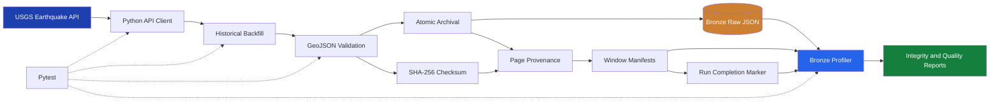

---

## Milestone 1: Initial API Ingestion

Milestone 1 establishes the foundational Python-based
ingestion pipeline for retrieving earthquake records
from the USGS Earthquake Catalog.

### Original Architecture

The following architecture is retained as a historical
reference to the original implementation.

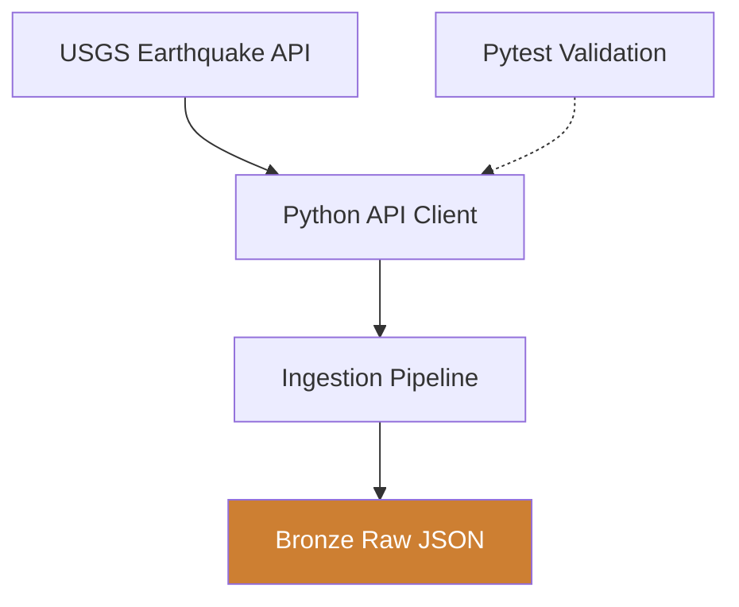

### Implemented Capabilities

- USGS API connectivity.
- Parameterized earthquake queries.
- Raw JSON extraction.
- Local Bronze archival.
- Initial response validation.
- Automated API client testing.

---

## Milestone 2: Historical Ingestion and Profiling

Milestone 2 extends the initial ingestion pipeline into
a historical extraction system capable of processing
large temporal ranges using bounded extraction windows,
pagination, record reconciliation, and independently
verifiable archives.

### Implemented Capabilities

- Configurable historical extraction windows.
- UTC-based event-time boundaries.
- Paginated USGS API extraction.
- Exponential backoff and retry jitter.
- GeoJSON structural validation.
- SHA-256 payload checksums.
- Atomic file publication without overwriting.
- Page-level provenance.
- Window-level ingestion manifests.
- Run-level completion manifests.
- Before-and-after source count reconciliation.
- Within-window event deduplication checks.
- Cross-window duplicate detection.
- Independent Bronze data profiling.
- Missing-field analysis.
- Statistical profiling.
- Geographic coordinate analysis.
- Automated integration and failure-handling tests.

### Historical Ingestion Architecture

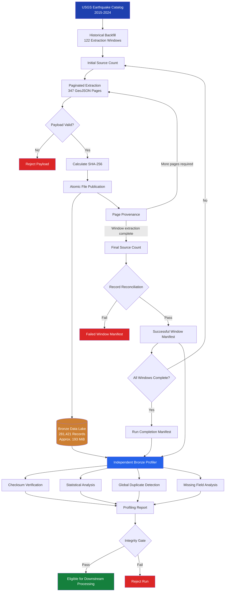

### Historical Extraction Sequence

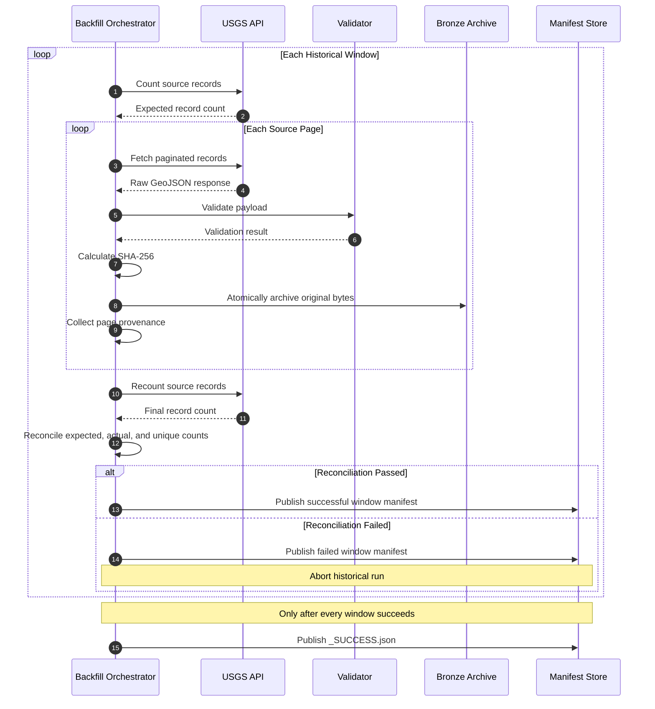

---

## Historical Dataset

The historical benchmark covers a magnitude-filtered
extraction of earthquake events occurring between
January 1, 2015, and December 31, 2024.

| Dataset Attribute | Value |
|---|---|
| Data source | USGS Earthquake Catalog |
| Source format | GeoJSON |
| Historical start | 2015-01-01 |
| Historical end (exclusive) | 2025-01-01 |
| Historical coverage | 3,653 days |
| Configured minimum magnitude | 2.5 |
| Extraction window | 30 days |
| Maximum records per page | 1,000 |
| Records ingested | 281,421 |
| Extraction windows | 122 |
| Archived GeoJSON pages | 347 |
| Window manifests | 122 |
| Approximate archive disk usage | 193 MiB |
| Ingestion status | SUCCESS |
| Unique event identifiers | 281,421 |
| Duplicate records | 0 |
| Record uniqueness | 100% |
| Exact payload bytes | 201,979,748 |
| Logical payload size | 192.62 MiB |
| Historical integrity status | PASS |

### Historical Run Identifier

```text
3d8d9a251f33489e807356890c692789
```

The historical dataset represents a filtered extraction
of the USGS catalog rather than every earthquake
recorded during the specified period.

Historical acceptance verification confirmed 281,421
unique event identifiers, zero duplicate records, and
a global integrity status of PASS.

---

## Performance Benchmarks

All measurements were recorded during local development
using the Python ingestion and profiling implementations.

### Historical Ingestion

| Metric | Measured Result |
|---|---:|
| Records ingested | 281,421 |
| Wall-clock duration | 226.760 seconds |
| Approximate throughput | 1,241 records/second |
| Extraction windows | 122 |
| Archived pages | 347 |
| Minimum logical API requests | 591 |
| Average records per window | 2,306.73 |
| Average records per page | 811.01 |
| Page capacity utilization | 81.1% |
| Approximate disk usage | 193 MiB |
| Shell-reported CPU utilization | 2% |

### Bronze Profiling

| Metric | Measured Result |
|---|---:|
| Wall-clock duration | 2.087 seconds |
| Shell-reported CPU utilization | 93% |
| Profiling report generation | Successful |
| Records verified | 281,421 |
| Unique events | 281,421 |
| Duplicate records | 0 |
| Logical payload bytes | 201,979,748 |
| Logical payload size | 192.62 MiB |
| Approximate profiling throughput | 134,845 records/second |
| Integrity status | PASS |
| Archived file count | 347 |
| Window manifest count | 122 |

The historical profiling report confirms that all 281,421
archived records reconcile successfully, with zero duplicate
event identifiers and 201,979,748 logical payload bytes.

### Historical Benchmark Comparison

| Metric | Daily Backfill | Ten-Year Backfill |
|---|---:|---:|
| Historical coverage | 1 day | 3,653 days |
| Records ingested | 111 | 281,421 |
| Page size | 10 | 1,000 |
| Extraction windows | 1 | 122 |
| Archived files | 12 | 347 |
| Execution duration | 2.954s | 226.760s |
| Records/second | 37.57 | 1,241.05 |

The ten-year extraction achieved approximately 33 times
the observed record throughput of the initial daily
extraction.

The experiments are not a controlled comparison because
dataset sizes, page sizes, and network conditions differ.

### Ingestion Throughput

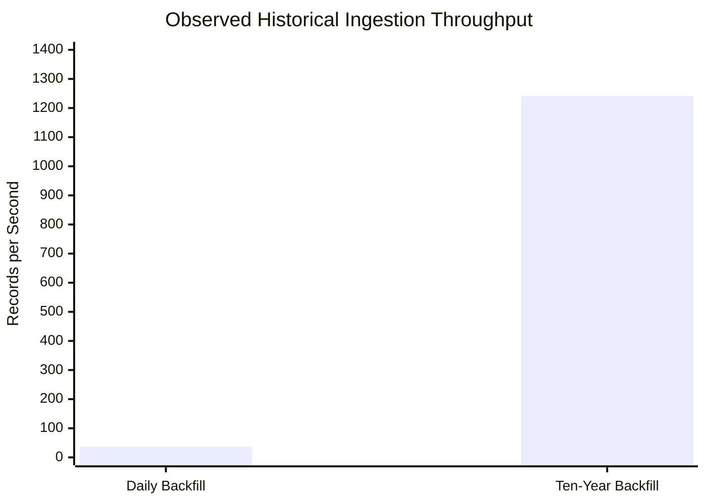

### Execution Duration

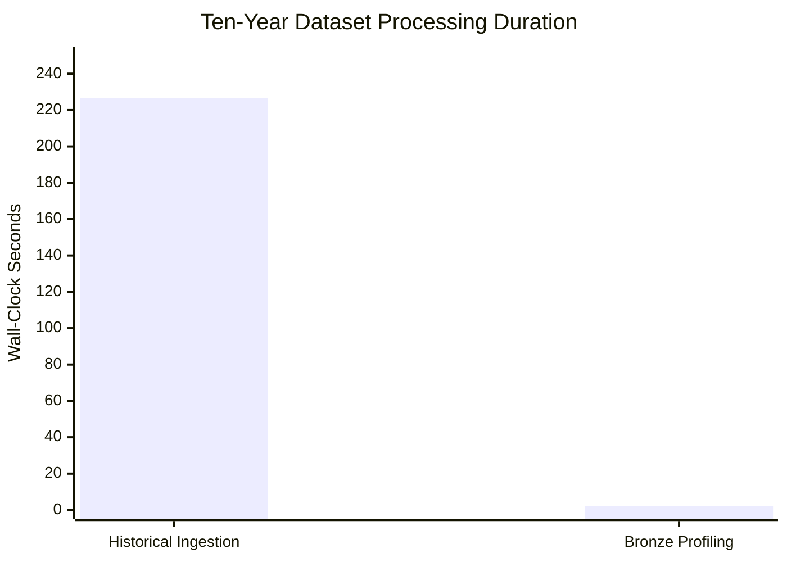

The ingestion pipeline is primarily network I/O-bound,
while local profiling performs substantially more CPU
work relative to its execution duration.

These benchmarks do not represent distributed Spark
or cloud-scale processing performance.

---

## Bronze Storage and Data Lineage

The Bronze layer preserves original USGS payloads
without modifying their scientific content.

Raw files are organized by ingestion date, execution
run ID, historical window, and pagination offset.

### Storage Structure

```text
data/
├── bronze/
│   └── ingestion_date=2026-11-22/
│       └── run_id=<run_id>/
│           ├── window_start=2015-01-01/
│           │   ├── offset_00000001.json
│           │   ├── offset_00001001.json
│           │   └── ...
│           └── ...
├── manifests/
│   └── run_id=<run_id>/
│       ├── 2015-01-01.json
│       ├── ...
│       └── _SUCCESS.json
├── profiles/
│   └── run_id=<run_id>/
│       └── profile_<profile_id>.json
├── silver/
└── gold/
```

### Bronze Storage Architecture

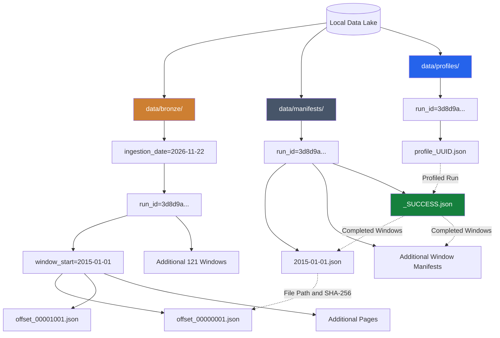

### Partitioning Strategy

| Attribute | Purpose |
|---|---|
| ingestion_date | Identifies when source data was retrieved |
| run_id | Separates independent ingestion executions |
| window_start | Identifies the historical extraction interval |
| pagination offset | Identifies an individual source response |

Ingestion time and event time remain separate concepts.

This distinction supports historical replay, incremental
processing, late-arriving event handling, and future
source revision tracking.

---

## Data Provenance

Every archived page is associated with provenance
metadata describing its source, extraction parameters,
storage location, and integrity checksum.

### Page-Level Manifest

| Attribute | Description |
|---|---|
| source_url | Original USGS query URL |
| source_file | Archived payload location |
| window_start | Historical interval start |
| window_end | Historical interval end |
| ingestion_time | UTC retrieval timestamp |
| min_magnitude | Source magnitude threshold |
| page_limit | Requested page capacity |
| offset | Source pagination offset |
| record_count | Records contained in the page |
| file_size_bytes | Archived payload size |
| sha256 | SHA-256 payload checksum |

### Window-Level Manifest

Each window manifest contains:

- Extraction run ID.
- Historical interval boundaries.
- Initial source record count.
- Final source record count.
- Archived record count.
- Unique event count.
- Reconciliation status.
- Referenced page manifests.

### Run-Level Manifest

The `_SUCCESS.json` completion marker records:

- Run identifier.
- Extraction configuration.
- Historical coverage.
- Execution start and completion timestamps.
- Total processing duration.
- Total completed windows.
- Total archived records.
- Total archived pages.
- Referenced window manifests.

A completion marker represents successful ingestion
reconciliation. It does not replace independent
archive integrity verification.

### Provenance Hierarchy

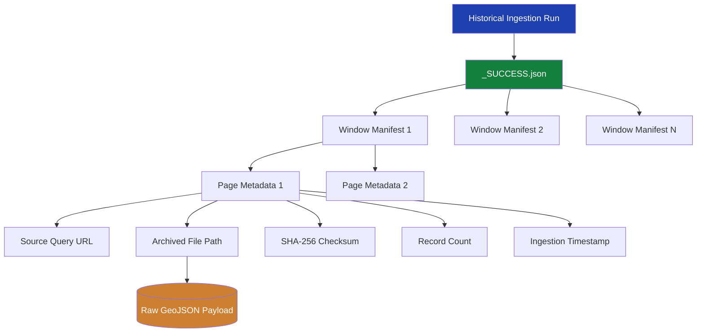

---

## Data Quality and Integrity

The platform separates source response validation,
extraction reconciliation, archive integrity, and
statistical profiling.

### Implemented Quality Controls

| Quality Control | Behavior |
|---|---|
| GeoJSON validation | Verify source response structure |
| Event identifiers | Require nonempty event IDs |
| Event timestamps | Require integer timestamps |
| Pagination | Verify page offsets and record counts |
| Source reconciliation | Compare expected and actual counts |
| Within-window duplicates | Detect repeated event IDs |
| Cross-window duplicates | Detect global repeated event IDs |
| File integrity | Recalculate SHA-256 checksums |
| File completeness | Verify referenced files exist |
| File-size verification | Reconcile expected and actual bytes |
| Missing attributes | Calculate counts and percentages |
| Geographic validity | Identify unusable coordinates |
| Run completeness | Require successful completion metadata |
| Statistical profiling | Calculate descriptive statistics |

### Integrity Verification Workflow

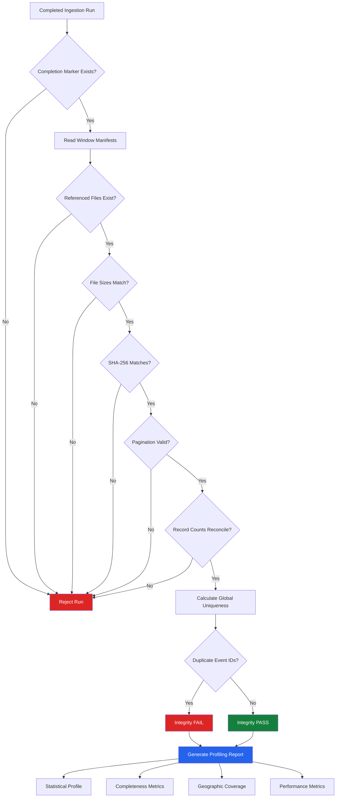

### Bronze Profiling Metrics

The profiler evaluates:

- Total archived records.
- Unique event identifiers.
- Duplicate records.
- Archived file counts.
- Logical payload bytes.
- Earliest and latest event timestamps.
- Minimum, maximum, mean, and median magnitude.
- Magnitude distributions.
- Longitude statistics.
- Latitude statistics.
- Earthquake depth statistics.
- Event classifications.
- Magnitude classifications.
- Missing-field counts and percentages.
- Historical ingestion throughput.

Optional data-quality observations do not automatically
cause an integrity failure.

Downstream scientific acceptance and quarantine rules
will be introduced during Silver-layer development.

---

## Milestone 3: Distributed PySpark Bronze Processing

Milestone 3 introduces a distributed Bronze processing layer built on
Apache Spark 3.5.3 and PySpark. It reads the immutable raw GeoJSON landing
zone, verifies every source file against its manifest checksum, explodes
nested features into event-level records with explicit scientific schemas,
and publishes a structured, columnar Parquet Bronze dataset.

The raw archive is **only read, never modified**. Structured outputs are
written to a separate `data/warehouse/bronze` tree so the verified
Milestone 2 archive is preserved byte-for-byte.

### Implemented Capabilities

- Centralized, reproducible SparkSession configuration (UTC, local master).
- Explicit PySpark schemas for the USGS GeoJSON FeatureCollection.
- Manifest-driven source discovery (run completion + window validation).
- Driver-side SHA-256 + byte-size verification before any Spark job.
- Distributed JSON parsing and feature explosion.
- Extraction of scientific attributes and full source/page provenance.
- Epoch-millisecond to UTC timestamp conversion.
- Columnar Parquet output partitioned by `event_year` (low cardinality).
- Independent post-write reconciliation against manifest totals.
- Idempotent reprocessing via dynamic partition overwrite.

### Bronze Processing Architecture

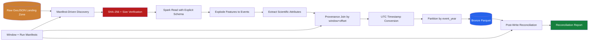

### Verified Acceptance Results

Measured on the historical run `3d8d9a251f33489e807356890c692789`
(Apple Silicon arm64, 18 cores, 48 GiB RAM; OpenJDK 17, Spark 3.5.3):

| Metric | Result |
|---|---:|
| Source files accounted for | 347 / 347 |
| Records reconciled | 281,421 / 281,421 |
| Duplicate events | 0 |
| Output Parquet size | 25.07 MiB |
| Compression vs raw payload | 7.68x |
| Processing duration (min of 3, warm JVM) | 2.56 s |
| Throughput | ~110,000 records/s |
| Idempotent re-run | No record multiplication |
| Integrity status | PASS |

Full methodology and per-repetition figures are in
[`docs/BENCHMARKS.md`](docs/BENCHMARKS.md); the Bronze schema is documented
in [`docs/data_dictionary/EARTHQUAKE_SCHEMA.md`](docs/data_dictionary/EARTHQUAKE_SCHEMA.md).

---

## Milestone 4: Silver Normalization and Data Quality

Milestone 4 transforms structured Bronze into a canonical scientific event
model with a configurable, independently-testable data-quality framework. It
standardizes categorical values (while retaining originals), validates records
against integrity and scientific-plausibility rules, deterministically selects
the current revision of each event, and separates valid from quarantined
records — without discarding scientifically legitimate values such as negative
depths.

### Implemented Capabilities

- Canonical event model with normalized categorical attributes.
- Deterministic content fingerprint per observation.
- Configurable quality rules (integrity, plausibility, completeness).
- Fatal vs warning severities (quarantine vs observe-only).
- Deterministic revision selection (latest `updated_time`, fingerprint tiebreak).
- Current-state and observed-revision datasets.
- Quarantine with full provenance and failed-rule capture.
- Reproducible per-rule data-quality results.
- Valid + quarantined + superseded reconciliation to Bronze input.

### Silver Normalization Architecture

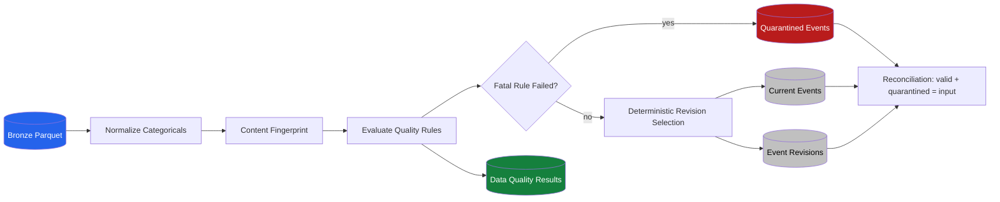

### Verified Acceptance Results

Measured on run `3d8d9a251f33489e807356890c692789`:

| Metric | Result |
|---|---:|
| Bronze input records | 281,421 |
| Valid records | 281,421 |
| Quarantined records | 0 |
| Current events | 281,421 |
| Superseded revisions | 0 |
| Fatal quality failures | 0 |
| Completeness warnings | 1 (missing `magType`) |
| Status normalization | `REVIEWED`+`reviewed` → 279,381 `reviewed` |
| Reconciliation | PASS |

See [`docs/DATA_QUALITY.md`](docs/DATA_QUALITY.md) for the rule catalog and
scientific justification of thresholds.

---

## Milestone 5: Delta Lake, Versioning, and Schema Evolution

Milestone 5 introduces transactional lakehouse tables using Delta Lake 3.2.1.
Silver outputs are merged into ACID Delta tables with idempotent MERGE
semantics, deterministic revision conflict resolution, controlled additive
schema evolution, time travel, and advance-only processing watermarks.

### Delta Tables

| Table | Namespace | Semantics |
|---|---|---|
| `earthquake_events_current` | silver | Upsert on `event_id`; newer `updated_time` wins |
| `earthquake_event_revisions` | silver | Insert-only on `(event_id, fingerprint)` |
| `quarantined_events` | silver | Upsert on `event_id` |
| `data_quality_results` | silver | Upsert on `(run_id, rule_id)` |
| `pipeline_runs` | metadata | Upsert on `(run_id, stage)` |
| `processing_watermarks` | metadata | Advance-only on `watermark_name` |

### Revision Management

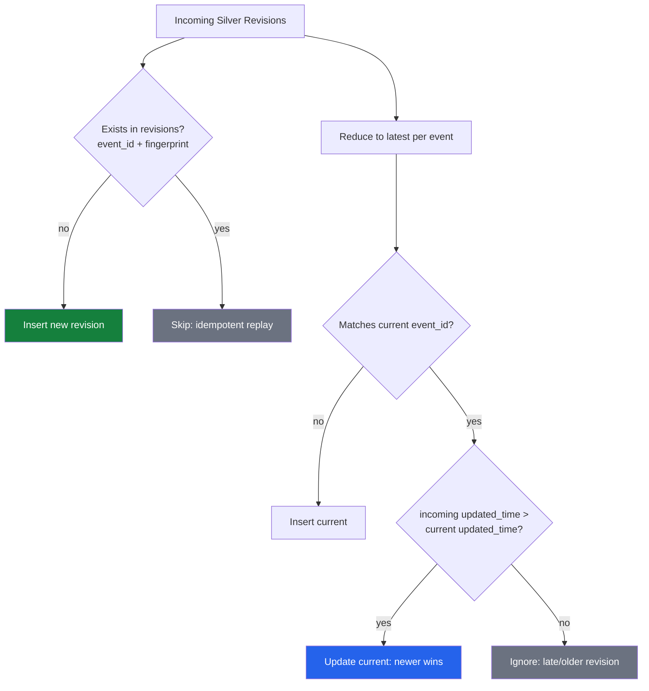

### Time Semantics

Four times are kept distinct: **event occurrence** (`event_time`), **source
revision** (`updated_time`), **ingestion** (`ingestion_timestamp`), and
**processing** (`processing_timestamp`). The project never claims to reconstruct
source revisions that were not actually observed and archived.

### Verified Acceptance Results

Measured on run `3d8d9a251f33489e807356890c692789`:

| Criterion | Result |
|---|---|
| Current events | 281,421 |
| Observed revisions | 281,421 |
| Reprocessing identical data | No new revisions (MERGE updated/inserted 0) |
| Newer revision updates current | Verified (unit + Delta history) |
| Older late-arriving revision ignored | Verified |
| Schema evolution (additive) | Verified via Delta auto-merge |
| Time travel | `versionAsOf 0` returns prior state |
| Transactional atomicity on failure | Table unchanged after failed MERGE |
| Watermark advance-only | Verified (never regresses) |

Single-writer Delta on local/object storage only; no concurrent multi-writer
guarantees are claimed.

---

## Target Enterprise Lakehouse Architecture

The target platform implements the Medallion architecture
pattern, separating raw source data, validated scientific
records, and analytical data products.

The following diagram represents the planned end-state
architecture following completion of all project milestones.

AWS S3, Spark, Delta Lake, Airflow, and infrastructure
automation are planned components and are not yet deployed.

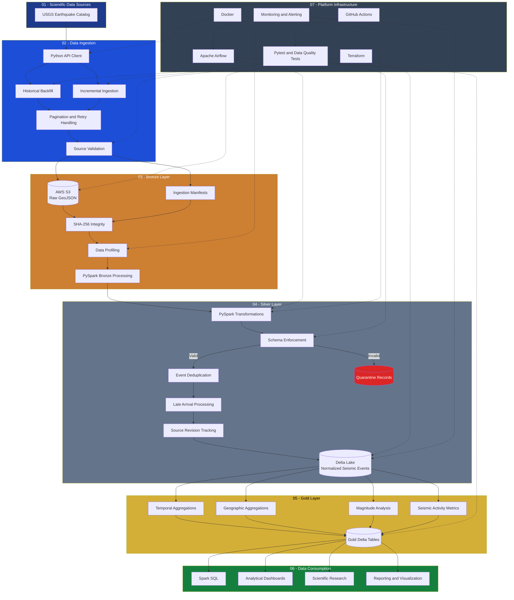

### Medallion Data Layers


| Layer | Responsibility | Status |
|---|---|---|
| Bronze | Original source payloads and provenance | Implemented locally |
| Silver | Validated and normalized scientific events | Planned |
| Gold | Aggregated analytical datasets | Planned |

---

## Technology Stack

### Implemented Technologies

| Technology | Purpose |
|---|---|
| Python 3.11 | Pipeline implementation |
| Requests | HTTP API connectivity |
| Pytest | Unit and integration testing |
| Ruff | Linting and formatting |
| JSON / GeoJSON | Source payload storage |
| SHA-256 | Payload integrity verification |
| Git | Source version control |
| GitHub | Repository hosting |

### Planned Technologies

| Technology | Purpose |
|---|---|
| Apache Spark | Distributed data processing |
| PySpark | Python-based Spark transformations |
| Apache Parquet | Columnar data storage |
| Delta Lake | Transactional lakehouse tables |
| AWS S3 | Cloud object storage |
| Apache Airflow | Workflow orchestration |
| Docker | Reproducible execution environments |
| Terraform | Infrastructure as code |
| GitHub Actions | CI/CD automation |

---

## Repository Structure

```text
scientific-event-lakehouse/
├── src/
│   ├── ingestion/
│   │   ├── archive.py
│   │   ├── backfill.py
│   │   ├── date_windows.py
│   │   ├── ingest.py
│   │   ├── manifest.py
│   │   ├── usgs_client.py
│   │   └── validation.py
│   └── profiling/
│       ├── __init__.py
│       └── profile_bronze.py
├── tests/
│   ├── test_archive.py
│   ├── test_backfill.py
│   ├── test_date_windows.py
│   ├── test_manifest.py
│   ├── test_profile_bronze.py
│   ├── test_profile_integration.py
│   ├── test_usgs_client.py
│   └── test_validation.py
├── data/
│   ├── bronze/
│   ├── manifests/
│   ├── profiles/
│   ├── silver/
│   └── gold/
├── .gitignore
├── requirements.txt
└── README.md
```

Generated data, manifests, and profiling reports are
excluded from version control.

---

## Getting Started

### Prerequisites

- Python 3.11 or compatible version.
- Git.
- Internet access for USGS API extraction.
- Sufficient local storage for historical datasets.

### Clone the Repository

```bash
git clone https://github.com/blkpvnthr/scientific-event-lakehouse.git

cd scientific-event-lakehouse
```

### Create a Virtual Environment

```bash
python3 -m venv .venv

source .venv/bin/activate
```

### Install Dependencies

```bash
python -m pip install --upgrade pip

python -m pip install -r requirements.txt
```

### Validate the Environment

```bash
python --version

ruff --version

python -m pytest --version
```

---

## Running the Pipeline

All execution commands should be run from the repository root.

### Initial API Ingestion

```bash
python -m src.ingestion.ingest
```

### Daily Historical Backfill

```bash
python -m src.ingestion.backfill \
    --start-date 2024-01-01 \
    --end-date 2024-01-02 \
    --window-days 1 \
    --min-magnitude 2.5 \
    --page-size 100
```

### Weekly Historical Backfill

```bash
python -m src.ingestion.backfill \
    --start-date 2024-01-01 \
    --end-date 2024-01-08 \
    --window-days 7 \
    --min-magnitude 2.5 \
    --page-size 1000
```

### Annual Historical Backfill

```bash
time python -m src.ingestion.backfill \
    --start-date 2024-01-01 \
    --end-date 2025-01-01 \
    --window-days 30 \
    --min-magnitude 2.5 \
    --page-size 1000
```

### Ten-Year Historical Backfill

```bash
time python -m src.ingestion.backfill \
    --start-date 2015-01-01 \
    --end-date 2025-01-01 \
    --window-days 30 \
    --min-magnitude 2.5 \
    --page-size 1000
```

### Configuration Parameters

| Parameter | Description |
|---|---|
| --start-date | Inclusive UTC start date |
| --end-date | Exclusive UTC end date |
| --window-days | Historical extraction window size |
| --min-magnitude | Minimum earthquake magnitude |
| --page-size | Maximum records requested per page |

### Inspect Run Completion

Replace the placeholder with the generated run identifier.

```bash
export RUN_ID="your_run_id"

python -m json.tool \
    "data/manifests/run_id=$RUN_ID/_SUCCESS.json"
```

### Execute Bronze Profiling

```bash
time python -m src.profiling.profile_bronze \
    --run-id "$RUN_ID"
```

### Locate Generated Profiling Reports

```bash
find "data/profiles/run_id=$RUN_ID" \
    -type f \
    -name "*.json"
```

### Inspect Archive Disk Usage

```bash
find data/bronze \
    -type d \
    -name "run_id=$RUN_ID" \
    -exec du -sh {} \;
```

### Count Archived Payloads

```bash
find data/bronze \
    -path "*/run_id=$RUN_ID/*" \
    -type f \
    -name "*.json" | wc -l
```

---

## Automated Testing

The testing strategy includes unit tests, component
integration tests, filesystem integrity checks, and
synthetic source responses.

Integration tests use temporary directories and
mocked API responses to avoid modifying historical
archives or requiring live network access.

### Regression Test Inventory

| Test Module | Test Cases |
|---|---:|
| GeoJSON validation | 28 |
| Historical backfill | 10 |
| Atomic archival | 10 |
| Ingestion manifests | 10 |
| Date-window generation | 6 |
| USGS API client | 3 |
| Profiling utilities | 11 |
| Profile integration | 13 |
| **Verified regression suite** | **91** |

The final regression suite passed all 91 automated tests
in 0.30 seconds. Ruff linting and formatting checks also
passed successfully across all 20 Python files.

### Testing Architecture

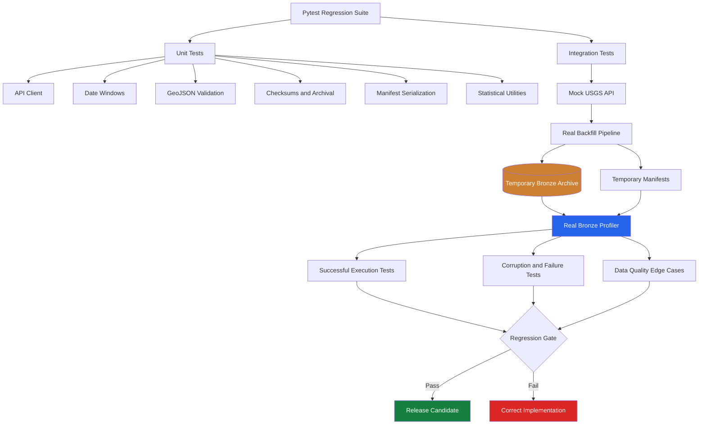

### Run the Full Regression Suite

```bash
python -m pytest -v
```

### Run Profiling Tests

```bash
python -m pytest \
    tests/test_profile_bronze.py \
    tests/test_profile_integration.py \
    -v
```

### Code Quality Checks

```bash
ruff check .
```

```bash
ruff format --check .
```

### Complete Release Quality Gate

```bash
ruff check . && \
ruff format --check . && \
python -m pytest -q && \
git diff --check
```

---

## Development Roadmap

The project follows a progressive implementation
strategy, beginning with reliable local ingestion
before introducing distributed processing, cloud
infrastructure, orchestration, and production controls.

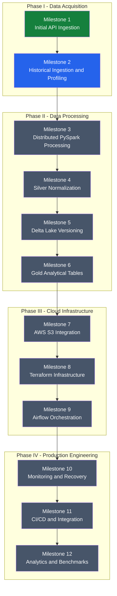

### Phase I: Data Acquisition

- [x] Implement USGS API connectivity.
- [x] Implement initial Bronze ingestion.
- [x] Implement historical extraction windows.
- [x] Implement pagination and retry handling.
- [x] Implement atomic archival.
- [x] Implement SHA-256 checksums.
- [x] Implement ingestion manifests.
- [x] Implement historical backfill orchestration.
- [x] Ingest ten years of historical records.
- [x] Implement Bronze profiling.
- [x] Implement profiler integration tests.
- [x] Confirm final 91-test regression suite.
- [x] Confirm ten-year global integrity results.
- [ ] Publish Milestone 2 release.

### Phase II: Distributed Data Processing

- [ ] Install and configure PySpark.
- [ ] Define explicit earthquake schemas.
- [ ] Parse historical Bronze GeoJSON files.
- [ ] Normalize nested source records.
- [ ] Implement distributed quality checks.
- [ ] Implement event deduplication.
- [ ] Implement Silver-layer transformations.
- [ ] Implement Delta Lake tables.
- [ ] Implement observed source revision history.
- [ ] Implement schema evolution.
- [ ] Implement Gold analytical aggregations.

### Phase III: Cloud Infrastructure

- [ ] Provision AWS S3 storage.
- [ ] Implement cloud storage integration.
- [ ] Define infrastructure with Terraform.
- [ ] Containerize execution environments.
- [ ] Configure Apache Airflow.
- [ ] Implement historical and incremental DAGs.
- [ ] Implement watermark management.

### Phase IV: Production Engineering

- [ ] Implement monitoring and alerting.
- [ ] Implement replay and recovery workflows.
- [ ] Establish data quality reporting.
- [ ] Implement GitHub Actions CI/CD.
- [ ] Implement infrastructure validation.
- [ ] Establish scalability benchmarks.
- [ ] Develop analytical dashboards.

---

## Known Limitations

The current implementation represents a local
historical ingestion and profiling platform.

- Historical extraction is sequential.
- Profiling retains event IDs and numerical measurements
  in memory.
- Distributed Spark processing is not yet implemented.
- Incremental watermark management is not yet implemented.
- Cloud object storage is not yet configured.
- Automated orchestration is not yet deployed.
- Failed runs may require a new ingestion execution.
- Raw archival prevents application-level overwrites but
  does not provide storage-enforced immutability.
- SHA-256 checksums detect payload changes relative to
  recorded manifests but do not authenticate the source.
- Matching source counts do not guarantee snapshot
  consistency against a mutable USGS catalog.
- Historical extraction does not reconstruct unavailable
  prior revisions of source events.
- Bronze integrity verification does not establish complete
  scientific validity.

These limitations will be addressed progressively
through subsequent project milestones.

---

## Upcoming Milestone

### Milestone 3: Distributed PySpark Bronze Processing

The next milestone introduces Apache Spark as the
distributed processing engine for the scientific
lakehouse.

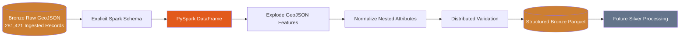

Planned implementation:

- Local Spark execution environment.
- Explicit PySpark schemas.
- Distributed GeoJSON parsing.
- Nested feature extraction.
- Event attribute normalization.
- Columnar Parquet storage.
- Partitioned data organization.
- Distributed record reconciliation.
- Transformation unit tests.
- Performance and scalability benchmarks.

---

## Data Source

USGS Earthquake Catalog

- Catalog: https://earthquake.usgs.gov/earthquakes/search/
- API Documentation: https://earthquake.usgs.gov/fdsnws/event/1/

Source records are retrieved from the public USGS
Earthquake Catalog and preserved for scientific
data engineering and analytical development.

---

## Project Status

Active development.

Latest completed implementation milestone: Historical ingestion and profiling (Milestone 2).

Release status: Verified and ready for publication.

Next milestone: Distributed PySpark Bronze processing.

---

## Milestone 2 Acceptance Report

**Verification date:** November 22, 2026

**Historical run:** `3d8d9a251f33489e807356890c692789`

| Acceptance Criterion | Result | Status |
|---|---|---|
| Historical extraction completed | 122 windows | PASS |
| Expected archived files | 347 | PASS |
| Record reconciliation | 281,421 records | PASS |
| Global event uniqueness | 281,421 unique events | PASS |
| Duplicate records | 0 | PASS |
| Logical payload size | 201,979,748 bytes | PASS |
| Historical coverage | 2015-01-01 to 2025-01-01 exclusive | PASS |
| Minimum magnitude threshold | 2.5 | PASS |
| Historical integrity | PASS | PASS |
| Automated regression suite | 91/91 | PASS |
| Regression execution time | 0.30 seconds | PASS |
| Ruff linting | All checks passed | PASS |
| Ruff formatting | 20 files formatted | PASS |

The historical ingestion and profiling implementation has
satisfied its defined technical acceptance criteria.

The dataset is eligible for subsequent distributed Bronze
processing, subject to the explicit schema and scientific
data quality requirements introduced in future milestones.

