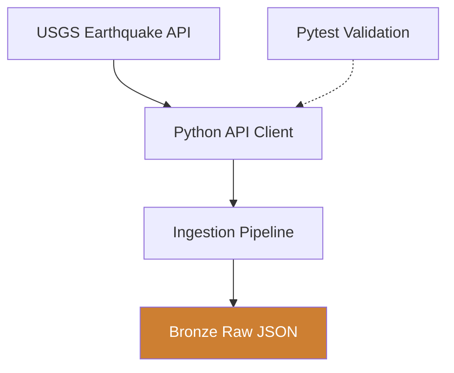

# Data-Lakehouse

# Scientific Event Data Lakehouse

A scientific data engineering platform for
ingesting, processing, and analyzing seismic
events using the USGS Earthquake Catalog.

## Current Architecture

## Current Status

Milestone 1: Initial API ingestion

## Planned Technology Stack

- Python
- PySpark
- AWS S3
- Delta Lake
- Apache Airflow
- Docker
- Terraform
- GitHub Actions