# Scientific Event Data Lakehouse

[](https://github.com/blkpvnthr/scientific-event-lakehouse/releases/tag/v1.0.0)

[](https://github.com/blkpvnthr/scientific-event-lakehouse/actions/workflows/ci.yml)


A **production-oriented reference implementation** of a scientific data
engineering platform that ingests, processes, validates, versions, and analyzes
seismic events from the [USGS Earthquake Catalog](https://earthquake.usgs.gov/earthquakes/search/).

**The engineering problem.** Scientific catalogs are revised continuously — events
are re-estimated, late observations arrive, and records change after first
publication. Turning this into trustworthy analytics requires immutable raw
capture, reconciled distributed processing, deterministic revision handling, and
end-to-end provenance — not just "load and query".

**What this is.** A complete Medallion Lakehouse over the USGS GeoJSON feed:
immutable **raw** archive (checksummed) → distributed **Bronze** Parquet (PySpark)
→ **Silver** canonical model + data quality + quarantine → transactional **Delta**
current-state and observed-revision tables → **Gold** star schema + 10 analytical
datasets → Spark SQL + a Streamlit dashboard. It is orchestrated with Airflow,
abstracted over local/S3 storage, provisioned via validated OpenTofu/Terraform,
observed with structured logging/metrics/recovery, and gated by GitHub Actions CI.

**Local verification vs cloud deployment.** Everything is implemented and verified
locally on the real 281,421-event dataset (local-mode Spark, single machine).
Cloud components (S3 buckets, IAM, managed orchestration) are **authored and
validated but not deployed** — no live AWS infrastructure is provisioned. Each
section below labels its verification status explicitly.

---

## Technical Achievements

Independently verified figures (see [`docs/RELEASE_AUDIT.md`](docs/RELEASE_AUDIT.md)
and [`docs/BENCHMARKS.md`](docs/BENCHMARKS.md)):

| Metric | Result |
|---|---:|
| Implementation milestones | 12 / 12 |
| Historical coverage | 2015-01-01 → 2025-01-01 (exclusive) |
| Historical event records | 281,421 |
| Unique event identifiers | 281,421 |
| Baseline duplicate records | 0 |
| Archived source files | 347 |
| Historical extraction windows | 122 |
| Original payload | 201,979,748 bytes (192.62 MiB) |
| Structured Bronze Parquet | ~25.1 MiB (**~7.7×** compression) |
| Gold analytical datasets | 10 |
| Reusable Spark SQL queries | 10 |
| Airflow DAGs | 3 |
| New logical revisions on identical replay | 0 (idempotent) |
| Automated tests | 158 passing, 1 skipped (+2 in the Airflow env) |
| Line coverage (`src/`) | 86% |
| CI jobs (GitHub Actions) | 5, all green |

> Measurements are local-mode Spark on a single machine — **not** distributed
> cloud-cluster performance.

---

## Table of Contents

1. [Project Objectives](#project-objectives)
2. [Technical Achievements](#technical-achievements)
3. [Current Status](#current-status)
4. [Current Architecture](#current-architecture)
5. [Milestone 1 — Initial API Ingestion](#milestone-1-initial-api-ingestion)
6. [Milestone 2 — Historical Ingestion and Profiling](#milestone-2-historical-ingestion-and-profiling)
7. [Historical Dataset](#historical-dataset)
8. [Performance Benchmarks](#performance-benchmarks)
9. [Bronze Storage and Data Lineage](#bronze-storage-and-data-lineage)
10. [Data Provenance](#data-provenance)
11. [Data Quality and Integrity](#data-quality-and-integrity)
12. [Milestone 3 — Distributed PySpark Bronze Processing](#milestone-3-distributed-pyspark-bronze-processing)
13. [Milestone 4 — Silver Normalization and Data Quality](#milestone-4-silver-normalization-and-data-quality)
14. [Milestone 5 — Delta Lake, Versioning, and Schema Evolution](#milestone-5-delta-lake-versioning-and-schema-evolution)
15. [Milestone 6 — Gold Analytical Data Products](#milestone-6-gold-analytical-data-products)
16. [Milestone 7 — AWS S3 Integration](#milestone-7-aws-s3-integration)
17. [Milestone 8 — Terraform Infrastructure](#milestone-8-terraform-infrastructure)
18. [Milestone 9 — Apache Airflow Orchestration](#milestone-9-apache-airflow-orchestration)
19. [Milestone 10 — Observability, Recovery, and Replay](#milestone-10-observability-recovery-and-replay)
20. [Milestone 11 — CI/CD and Production Testing](#milestone-11-cicd-and-production-testing)
21. [Milestone 12 — Analytics Dashboard, Documentation, and Benchmarks](#milestone-12-analytics-dashboard-documentation-and-benchmarks)
22. [Complete Lakehouse Architecture](#complete-lakehouse-architecture)
23. [Technology Stack](#technology-stack)
24. [Repository Structure](#repository-structure)
25. [Getting Started](#getting-started)
26. [Running the Pipeline](#running-the-pipeline)
27. [Analytics Dashboard](#analytics-dashboard)
28. [Automated Testing](#automated-testing)
29. [Development Roadmap](#development-roadmap)
30. [Completed End-to-End Data Flow](#completed-end-to-end-data-flow)
31. [Known Limitations](#known-limitations)
32. [Releases](#releases)
33. [Technical Documentation](#technical-documentation)
34. [Data Source](#data-source)

---

## Project Objectives

- Build reliable historical and incremental data pipelines.
- Preserve original scientific source records.
- Implement Bronze, Silver, and Gold data layers.
- Establish reproducible data processing workflows.
- Implement file-level and record-level integrity checks.
- Support historical replay and recovery.
- Handle late-arriving events and source revisions.
- Implement distributed processing using Apache Spark.
- Implement transactional tables using Delta Lake.
- Provision cloud infrastructure using Terraform.
- Automate workflows using Apache Airflow.
- Establish monitoring, testing, and CI/CD controls.
- Produce analytical datasets for scientific research.

---

## Current Status

| Milestone | Description | Status |
|---|---|---|
| 1 | Initial USGS API ingestion | Complete |
| 2 | Historical ingestion, archival, and profiling | Complete |
| 3 | Distributed PySpark Bronze processing | Complete (locally verified) |
| 4 | Silver normalization and data quality | Complete (locally verified) |
| 5 | Delta Lake versioning and schema evolution | Complete (locally verified) |
| 6 | Gold analytical transformations | Complete (locally verified) |
| 7 | AWS S3 integration | Complete (local + mocked S3) |
| 8 | Terraform infrastructure | Complete (validated, not applied) |
| 9 | Apache Airflow orchestration | Complete (DAGs import-verified) |
| 10 | Monitoring, recovery, and replay | Complete (locally verified) |
| 11 | CI/CD and system integration | Complete (workflows validated) |
| 12 | Analytics, documentation, and benchmarks | Complete (locally verified) |

---

## Current Architecture

The v1.0.0 architecture implements the complete Medallion Lakehouse: immutable
raw capture, distributed Bronze processing, Silver normalization + data quality,
transactional Delta current-state and observed-revision tables, Gold analytical
products, and dashboard/SQL consumption. Data dependencies below reflect the
actual implementation.

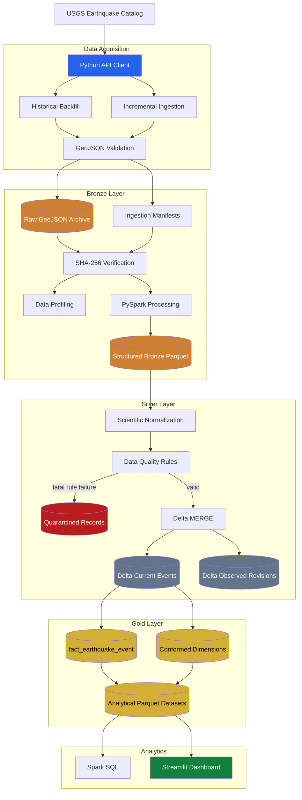

Orchestration (Airflow), storage abstraction (local/S3), infrastructure
(OpenTofu/Terraform), observability/recovery, and CI/CD wrap this pipeline and are
detailed in the milestone sections below.

---

## Milestone 1: Initial API Ingestion

Milestone 1 establishes the foundational Python-based
ingestion pipeline for retrieving earthquake records
from the USGS Earthquake Catalog.

### Original Architecture

The following architecture is retained as a historical
reference to the original implementation.

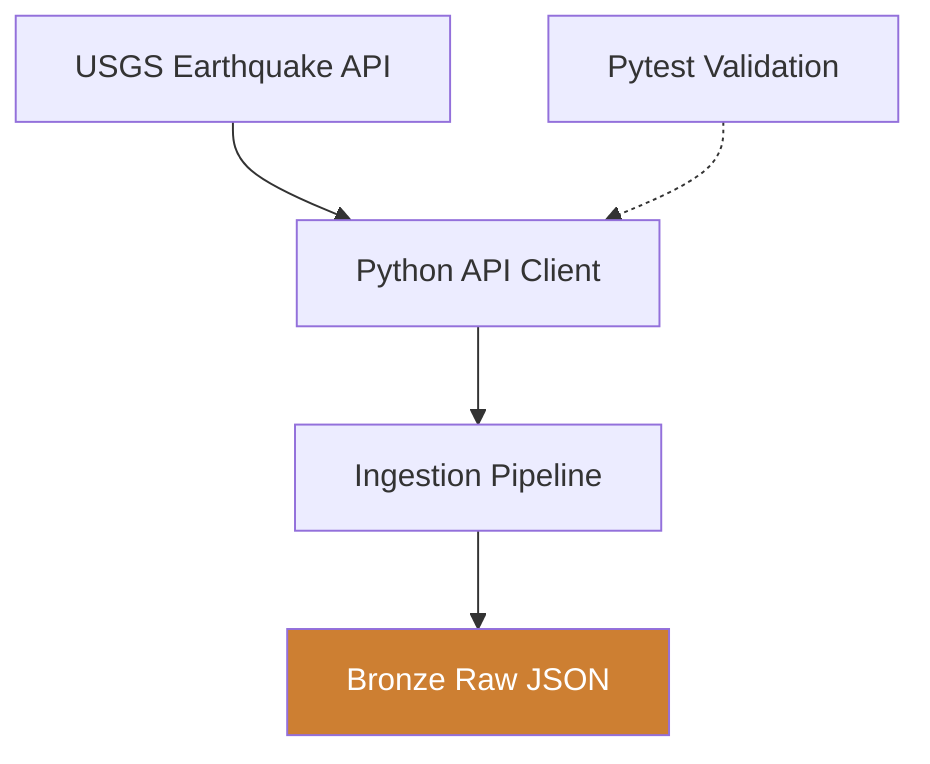

### Implemented Capabilities

- USGS API connectivity.
- Parameterized earthquake queries.
- Raw JSON extraction.
- Local Bronze archival.
- Initial response validation.
- Automated API client testing.

---

## Milestone 2: Historical Ingestion and Profiling

Milestone 2 extends the initial ingestion pipeline into
a historical extraction system capable of processing
large temporal ranges using bounded extraction windows,
pagination, record reconciliation, and independently
verifiable archives.

### Implemented Capabilities

- Configurable historical extraction windows.
- UTC-based event-time boundaries.
- Paginated USGS API extraction.
- Exponential backoff and retry jitter.
- GeoJSON structural validation.
- SHA-256 payload checksums.
- Atomic file publication without overwriting.
- Page-level provenance.
- Window-level ingestion manifests.
- Run-level completion manifests.
- Before-and-after source count reconciliation.
- Within-window event deduplication checks.
- Cross-window duplicate detection.
- Independent Bronze data profiling.
- Missing-field analysis.
- Statistical profiling.
- Geographic coordinate analysis.
- Automated integration and failure-handling tests.

### Historical Ingestion Architecture

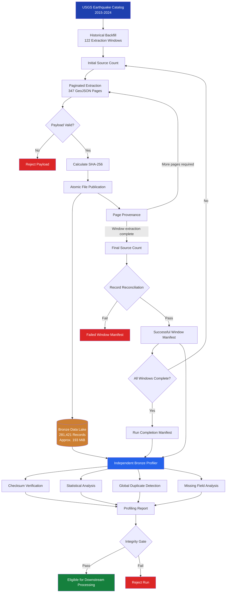

### Historical Extraction Sequence

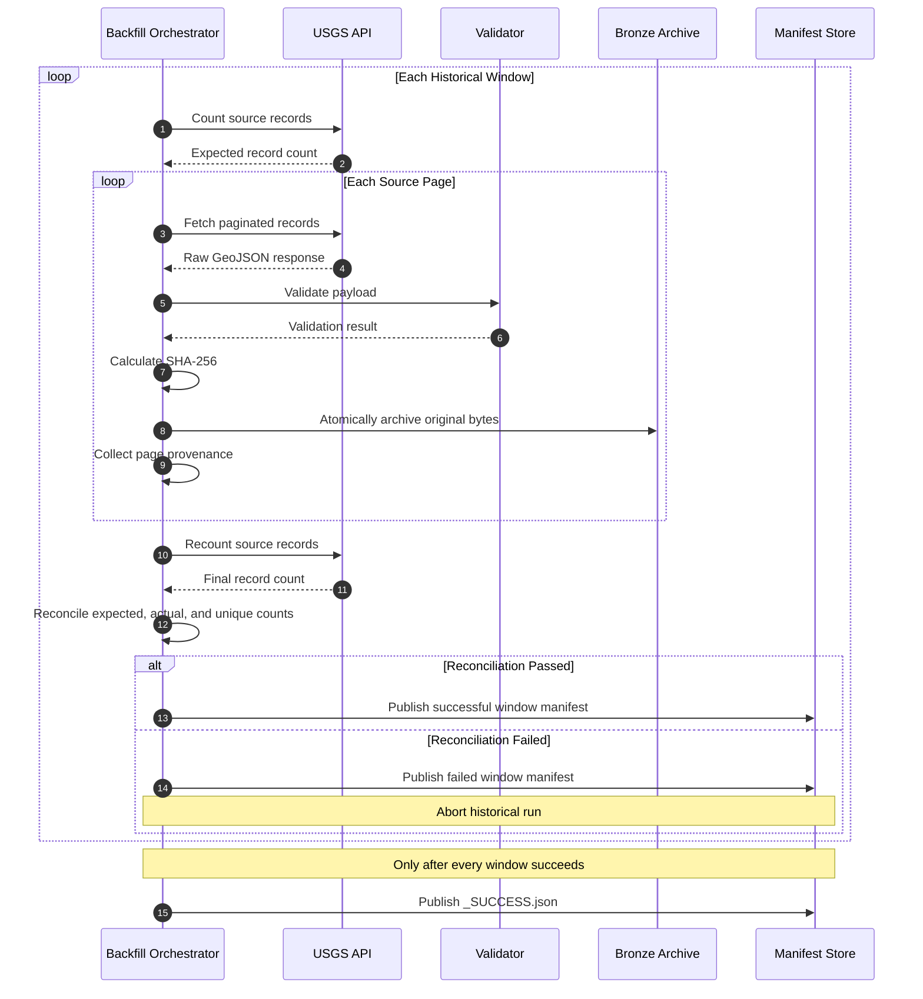

---

## Historical Dataset

The historical benchmark covers a magnitude-filtered
extraction of earthquake events occurring between
January 1, 2015, and December 31, 2024.

| Dataset Attribute | Value |
|---|---|
| Data source | USGS Earthquake Catalog |
| Source format | GeoJSON |
| Historical start | 2015-01-01 |
| Historical end (exclusive) | 2025-01-01 |
| Historical coverage | 3,653 days |
| Configured minimum magnitude | 2.5 |
| Extraction window | 30 days |
| Maximum records per page | 1,000 |
| Records ingested | 281,421 |
| Extraction windows | 122 |
| Archived GeoJSON pages | 347 |
| Window manifests | 122 |
| Approximate archive disk usage | 193 MiB |
| Ingestion status | SUCCESS |
| Unique event identifiers | 281,421 |
| Duplicate records | 0 |
| Record uniqueness | 100% |
| Exact payload bytes | 201,979,748 |
| Logical payload size | 192.62 MiB |
| Historical integrity status | PASS |

### Historical Run Identifier

```text
3d8d9a251f33489e807356890c692789
```

The historical dataset represents a filtered extraction
of the USGS catalog rather than every earthquake
recorded during the specified period.

Historical acceptance verification confirmed 281,421
unique event identifiers, zero duplicate records, and
a global integrity status of PASS.

---

## Performance Benchmarks

All measurements were recorded during local development
using the Python ingestion and profiling implementations.

### Historical Ingestion

| Metric | Measured Result |
|---|---:|
| Records ingested | 281,421 |
| Wall-clock duration | 226.760 seconds |
| Approximate throughput | 1,241 records/second |
| Extraction windows | 122 |
| Archived pages | 347 |
| Minimum logical API requests | 591 |
| Average records per window | 2,306.73 |
| Average records per page | 811.01 |
| Page capacity utilization | 81.1% |
| Approximate disk usage | 193 MiB |
| Shell-reported CPU utilization | 2% |

### Bronze Profiling

| Metric | Measured Result |
|---|---:|
| Wall-clock duration | 2.087 seconds |
| Shell-reported CPU utilization | 93% |
| Profiling report generation | Successful |
| Records verified | 281,421 |
| Unique events | 281,421 |
| Duplicate records | 0 |
| Logical payload bytes | 201,979,748 |
| Logical payload size | 192.62 MiB |
| Approximate profiling throughput | 134,845 records/second |
| Integrity status | PASS |
| Archived file count | 347 |
| Window manifest count | 122 |

The historical profiling report confirms that all 281,421
archived records reconcile successfully, with zero duplicate
event identifiers and 201,979,748 logical payload bytes.

### Historical Benchmark Comparison

| Metric | Daily Backfill | Ten-Year Backfill |
|---|---:|---:|
| Historical coverage | 1 day | 3,653 days |
| Records ingested | 111 | 281,421 |
| Page size | 10 | 1,000 |
| Extraction windows | 1 | 122 |
| Archived files | 12 | 347 |
| Execution duration | 2.954s | 226.760s |
| Records/second | 37.57 | 1,241.05 |

The ten-year extraction achieved approximately 33 times
the observed record throughput of the initial daily
extraction.

The experiments are not a controlled comparison because
dataset sizes, page sizes, and network conditions differ.

### Ingestion Throughput

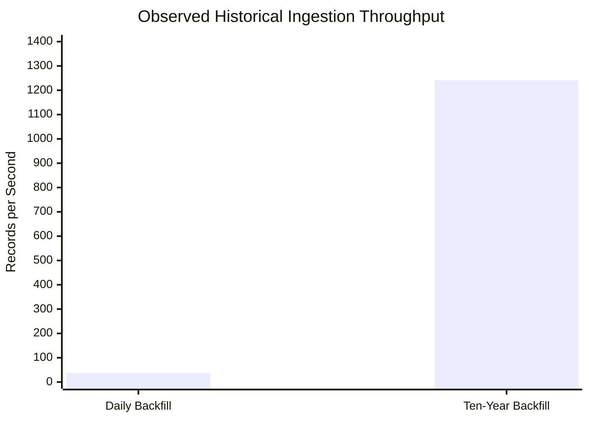

### Execution Duration

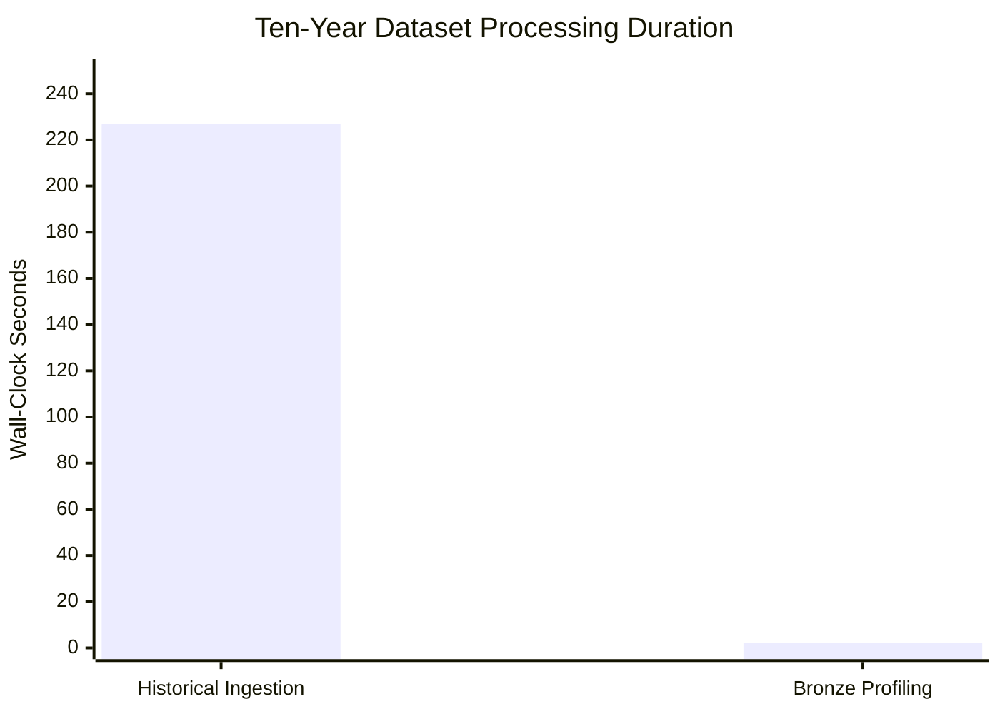

The ingestion pipeline is primarily network I/O-bound,
while local profiling performs substantially more CPU
work relative to its execution duration.

These benchmarks do not represent distributed Spark
or cloud-scale processing performance.

---

## Bronze Storage and Data Lineage

The Bronze layer preserves original USGS payloads
without modifying their scientific content.

Raw files are organized by ingestion date, execution
run ID, historical window, and pagination offset.

### Storage Structure

```text
data/
├── bronze/
│   └── ingestion_date=2026-11-22/
│       └── run_id=<run_id>/
│           ├── window_start=2015-01-01/
│           │   ├── offset_00000001.json
│           │   ├── offset_00001001.json
│           │   └── ...
│           └── ...
├── manifests/
│   └── run_id=<run_id>/
│       ├── 2015-01-01.json
│       ├── ...
│       └── _SUCCESS.json
├── profiles/
│   └── run_id=<run_id>/
│       └── profile_<profile_id>.json
├── silver/
└── gold/
```

### Bronze Storage Architecture

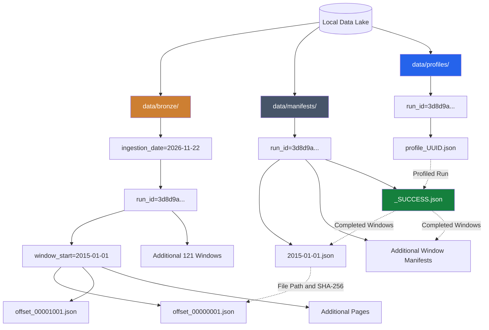

### Partitioning Strategy

| Attribute | Purpose |
|---|---|
| ingestion_date | Identifies when source data was retrieved |
| run_id | Separates independent ingestion executions |
| window_start | Identifies the historical extraction interval |
| pagination offset | Identifies an individual source response |

Ingestion time and event time remain separate concepts.

This distinction supports historical replay, incremental
processing, late-arriving event handling, and future
source revision tracking.

---

## Data Provenance

Every archived page is associated with provenance
metadata describing its source, extraction parameters,
storage location, and integrity checksum.

### Page-Level Manifest

| Attribute | Description |
|---|---|
| source_url | Original USGS query URL |
| source_file | Archived payload location |
| window_start | Historical interval start |
| window_end | Historical interval end |
| ingestion_time | UTC retrieval timestamp |
| min_magnitude | Source magnitude threshold |
| page_limit | Requested page capacity |
| offset | Source pagination offset |
| record_count | Records contained in the page |
| file_size_bytes | Archived payload size |
| sha256 | SHA-256 payload checksum |

### Window-Level Manifest

Each window manifest contains:

- Extraction run ID.
- Historical interval boundaries.
- Initial source record count.
- Final source record count.
- Archived record count.
- Unique event count.
- Reconciliation status.
- Referenced page manifests.

### Run-Level Manifest

The `_SUCCESS.json` completion marker records:

- Run identifier.
- Extraction configuration.
- Historical coverage.
- Execution start and completion timestamps.
- Total processing duration.
- Total completed windows.
- Total archived records.
- Total archived pages.
- Referenced window manifests.

A completion marker represents successful ingestion
reconciliation. It does not replace independent
archive integrity verification.

### Provenance Hierarchy

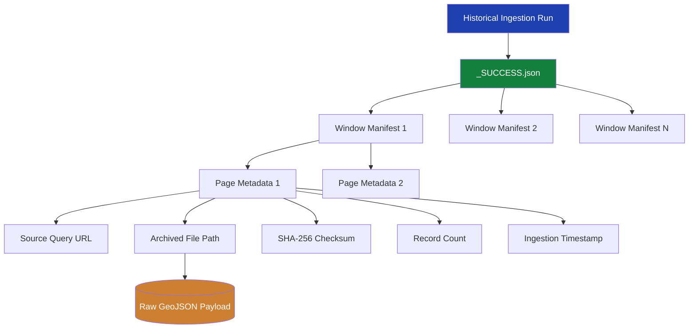

---

## Data Quality and Integrity

The platform separates source response validation,
extraction reconciliation, archive integrity, and
statistical profiling.

### Implemented Quality Controls

| Quality Control | Behavior |
|---|---|
| GeoJSON validation | Verify source response structure |
| Event identifiers | Require nonempty event IDs |
| Event timestamps | Require integer timestamps |
| Pagination | Verify page offsets and record counts |
| Source reconciliation | Compare expected and actual counts |
| Within-window duplicates | Detect repeated event IDs |
| Cross-window duplicates | Detect global repeated event IDs |
| File integrity | Recalculate SHA-256 checksums |
| File completeness | Verify referenced files exist |
| File-size verification | Reconcile expected and actual bytes |
| Missing attributes | Calculate counts and percentages |
| Geographic validity | Identify unusable coordinates |
| Run completeness | Require successful completion metadata |
| Statistical profiling | Calculate descriptive statistics |

### Integrity Verification Workflow

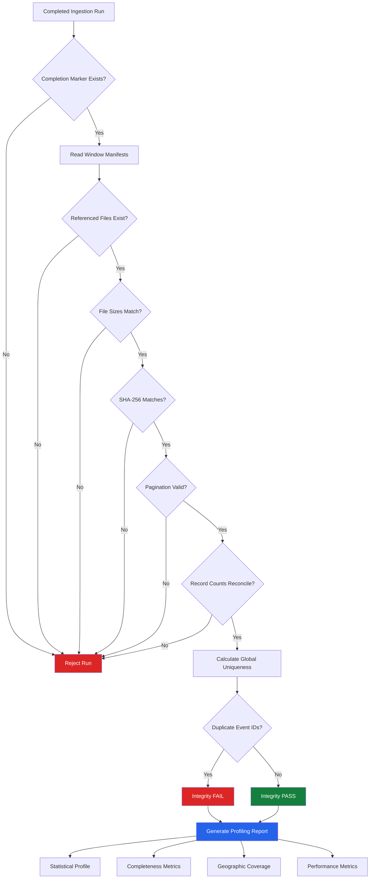

### Bronze Profiling Metrics

The profiler evaluates:

- Total archived records.
- Unique event identifiers.
- Duplicate records.
- Archived file counts.
- Logical payload bytes.
- Earliest and latest event timestamps.
- Minimum, maximum, mean, and median magnitude.
- Magnitude distributions.
- Longitude statistics.
- Latitude statistics.
- Earthquake depth statistics.
- Event classifications.
- Magnitude classifications.
- Missing-field counts and percentages.
- Historical ingestion throughput.

Optional data-quality observations do not automatically
cause an integrity failure.

Downstream scientific acceptance and quarantine rules
will be introduced during Silver-layer development.

---

## Milestone 3: Distributed PySpark Bronze Processing

Milestone 3 introduces a distributed Bronze processing layer built on
Apache Spark 3.5.3 and PySpark. It reads the immutable raw GeoJSON landing
zone, verifies every source file against its manifest checksum, explodes
nested features into event-level records with explicit scientific schemas,
and publishes a structured, columnar Parquet Bronze dataset.

The raw archive is **only read, never modified**. Structured outputs are
written to a separate `data/warehouse/bronze` tree so the verified
Milestone 2 archive is preserved byte-for-byte.

### Implemented Capabilities

- Centralized, reproducible SparkSession configuration (UTC, local master).
- Explicit PySpark schemas for the USGS GeoJSON FeatureCollection.
- Manifest-driven source discovery (run completion + window validation).
- Driver-side SHA-256 + byte-size verification before any Spark job.
- Distributed JSON parsing and feature explosion.
- Extraction of scientific attributes and full source/page provenance.
- Epoch-millisecond to UTC timestamp conversion.
- Columnar Parquet output partitioned by `event_year` (low cardinality).
- Independent post-write reconciliation against manifest totals.
- Idempotent reprocessing via dynamic partition overwrite.

### Bronze Processing Architecture

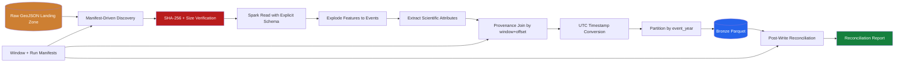

### Verified Acceptance Results

Measured on the historical run `3d8d9a251f33489e807356890c692789`
(Apple Silicon arm64, 18 cores, 48 GiB RAM; OpenJDK 17, Spark 3.5.3):

| Metric | Result |
|---|---:|
| Source files accounted for | 347 / 347 |
| Records reconciled | 281,421 / 281,421 |
| Duplicate events | 0 |
| Output Parquet size | 25.07 MiB |
| Compression vs raw payload | 7.68x |
| Processing duration (min of 3, warm JVM) | 2.56 s |
| Throughput | ~110,000 records/s |
| Idempotent re-run | No record multiplication |
| Integrity status | PASS |

Full methodology and per-repetition figures are in
[`docs/BENCHMARKS.md`](docs/BENCHMARKS.md); the Bronze schema is documented
in [`docs/data_dictionary/EARTHQUAKE_SCHEMA.md`](docs/data_dictionary/EARTHQUAKE_SCHEMA.md).

---

## Milestone 4: Silver Normalization and Data Quality

Milestone 4 transforms structured Bronze into a canonical scientific event
model with a configurable, independently-testable data-quality framework. It
standardizes categorical values (while retaining originals), validates records
against integrity and scientific-plausibility rules, deterministically selects
the current revision of each event, and separates valid from quarantined
records — without discarding scientifically legitimate values such as negative
depths.

### Implemented Capabilities

- Canonical event model with normalized categorical attributes.
- Deterministic content fingerprint per observation.
- Configurable quality rules (integrity, plausibility, completeness).
- Fatal vs warning severities (quarantine vs observe-only).
- Deterministic revision selection (latest `updated_time`, fingerprint tiebreak).
- Current-state and observed-revision datasets.
- Quarantine with full provenance and failed-rule capture.
- Reproducible per-rule data-quality results.
- Valid + quarantined + superseded reconciliation to Bronze input.

### Silver Normalization Architecture

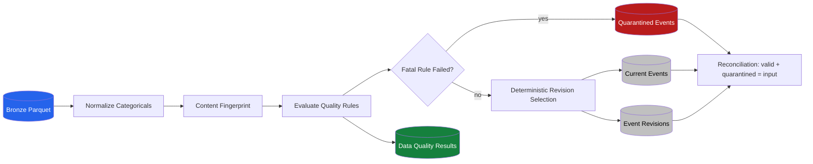

### Verified Acceptance Results

Measured on run `3d8d9a251f33489e807356890c692789`:

| Metric | Result |
|---|---:|
| Bronze input records | 281,421 |
| Valid records | 281,421 |
| Quarantined records | 0 |
| Current events | 281,421 |
| Superseded revisions | 0 |
| Fatal quality failures | 0 |
| Completeness warnings | 1 (missing `magType`) |
| Status normalization | `REVIEWED`+`reviewed` → 279,381 `reviewed` |
| Reconciliation | PASS |

See [`docs/DATA_QUALITY.md`](docs/DATA_QUALITY.md) for the rule catalog and
scientific justification of thresholds.

---

## Milestone 5: Delta Lake, Versioning, and Schema Evolution

Milestone 5 introduces transactional lakehouse tables using Delta Lake 3.2.1.
Silver outputs are merged into ACID Delta tables with idempotent MERGE
semantics, deterministic revision conflict resolution, controlled additive
schema evolution, time travel, and advance-only processing watermarks.

### Delta Tables

| Table | Namespace | Semantics |
|---|---|---|
| `earthquake_events_current` | silver | Upsert on `event_id`; newer `updated_time` wins |
| `earthquake_event_revisions` | silver | Insert-only on `(event_id, fingerprint)` |
| `quarantined_events` | silver | Upsert on `event_id` |
| `data_quality_results` | silver | Upsert on `(run_id, rule_id)` |
| `pipeline_runs` | metadata | Upsert on `(run_id, stage)` |
| `processing_watermarks` | metadata | Advance-only on `watermark_name` |

### Revision Management

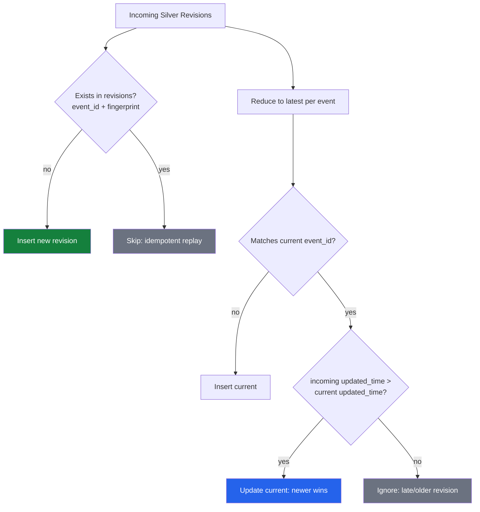

### Time Semantics

Four times are kept distinct: **event occurrence** (`event_time`), **source
revision** (`updated_time`), **ingestion** (`ingestion_timestamp`), and
**processing** (`processing_timestamp`). The project never claims to reconstruct
source revisions that were not actually observed and archived.

### Verified Acceptance Results

Measured on run `3d8d9a251f33489e807356890c692789`:

| Criterion | Result |
|---|---|
| Current events | 281,421 |
| Observed revisions | 281,421 |
| Reprocessing identical data | No new revisions (MERGE updated/inserted 0) |
| Newer revision updates current | Verified (unit + Delta history) |
| Older late-arriving revision ignored | Verified |
| Schema evolution (additive) | Verified via Delta auto-merge |
| Time travel | `versionAsOf 0` returns prior state |
| Transactional atomicity on failure | Table unchanged after failed MERGE |
| Watermark advance-only | Verified (never regresses) |

Single-writer Delta on local/object storage only; no concurrent multi-writer
guarantees are claimed.

---

## Milestone 6: Gold Analytical Data Products

Milestone 6 builds a documented star schema and ten analytical datasets from the
transactional Silver `earthquake_events_current` table, plus ten reusable Spark
SQL queries. All aggregates derive from the same validated current-state table,
so Gold counts reconcile to it.

### Dimensional Model

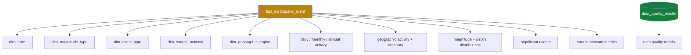

### Implemented Capabilities

- Star schema: `fact_earthquake_event` + five conformed dimensions.
- Ten analytical datasets (daily/monthly/annual, geographic, magnitude, depth,
  significant events, hotspots, network metrics, quality trends).
- Ten reusable Spark SQL queries (`sql/analytics/`) demonstrating CTEs, window
  functions (lag, rank, rolling range), ranking, and conditional aggregation.
- Fact reconciliation to the current-events table.

### Verified Acceptance Results

Built from 281,421 current events (run `3d8d9a25…`):

| Dataset | Rows |
|---|---:|
| `fact_earthquake_event` (reconciled) | 281,421 |
| `dim_date` | 3,653 |
| `annual_seismic_activity` | 10 |
| `monthly_seismic_activity` | 120 |
| `significant_events` (M≥6 or sig≥600) | 1,861 |
| `geographic_seismic_activity` / `seismic_hotspots` | 435 cells |
| `source_network_metrics` | 20 |

All ten analytics SQL queries execute successfully. See
[`docs/architecture/DATA_MODEL.md`](docs/architecture/DATA_MODEL.md) and
[`docs/data_dictionary/GOLD_TABLES.md`](docs/data_dictionary/GOLD_TABLES.md).
These are descriptive summaries of a magnitude-filtered catalog, **not**
earthquake prediction.

---

## Milestone 7: AWS S3 Integration

Milestone 7 adds a storage abstraction (`src/storage`) supporting local
filesystem and AWS S3 behind one interface. Local development and CI require no
AWS credentials; switching to S3 is configuration only. S3 behavior is verified
against a mocked S3 service (moto) — no real AWS resources are created.

### Implemented Capabilities

- `StorageBackend` interface with `LocalStorage` and `S3Storage`.
- Environment-based backend selection (`STORAGE_BACKEND`).
- AWS-native credential discovery (no hard-coded secrets).
- Deterministic keys; raw / bronze / silver / gold / metadata prefix separation.
- Append-only writes (no silent overwrite) with explicit opt-in.
- Spark `s3a://` configuration helper (single-writer Delta on S3).
- Integration tests against mocked S3.

### Storage Abstraction

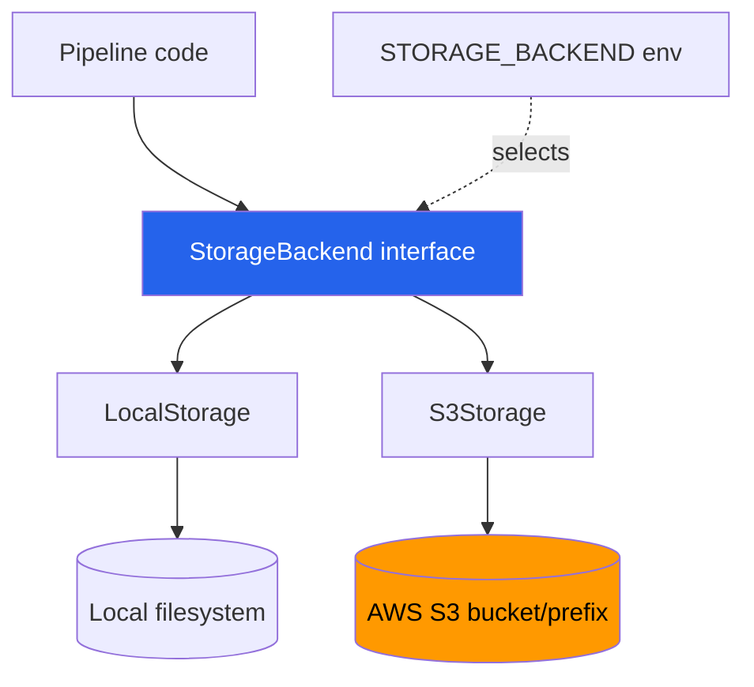

### Verified Acceptance Results

- 11 storage tests pass (local + mocked S3).
- Local execution works without AWS credentials.
- S3 paths are deterministic; existing objects are not silently overwritten.
- Raw, processed, and metadata locations are separated by prefix.

Single-writer Delta on S3 only; no concurrent multi-writer guarantees are
claimed. See [`docs/DEPLOYMENT.md`](docs/DEPLOYMENT.md) and
[`docs/SECURITY.md`](docs/SECURITY.md).

---

## Milestone 8: Terraform Infrastructure

Milestone 8 provides Infrastructure as Code for the AWS deployment: a secure S3
bucket and a least-privilege IAM role, as reusable modules composed per
environment. Configuration is validated locally; no resources are applied.

### Infrastructure

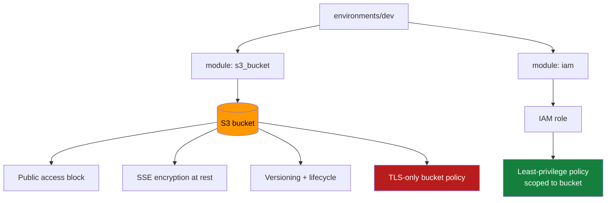

### Implemented Capabilities

- Reusable `s3_bucket` and `iam` modules + `environments/dev` composition.
- Public-access block, encryption at rest, TLS-only policy, versioning,
  lifecycle expiry of noncurrent versions.
- Least-privilege IAM role/policy scoped to a single bucket.
- Provider version constraints, variables, outputs, example tfvars.

### Verified Acceptance Results

Validated with OpenTofu 1.13.9 (HCL-compatible with Terraform):

```
tofu fmt -check -recursive .   -> OK
tofu init -backend=false       -> success
tofu validate                  -> Success! The configuration is valid.
```

`terraform apply` is **never** run automatically (it creates billable resources
and needs authorization). See [`infrastructure/terraform/README.md`](infrastructure/terraform/README.md)
and [`docs/CLOUD_COST_ESTIMATES.md`](docs/CLOUD_COST_ESTIMATES.md).

---

## Milestone 9: Apache Airflow Orchestration

Milestone 9 adds reproducible workflow orchestration via Airflow and Docker.
Orchestration logic lives in an Airflow-agnostic `src/orchestration` module (heavy
imports deferred so DAGs parse without Spark), keeping tasks thin, idempotent, and
unit-testable.

### DAGs

| DAG | Purpose |
|---|---|
| `historical_processing` | validate → Bronze → Silver → quality gate → Delta merge → Gold → reconcile → **commit watermark** → report |
| `incremental_ingestion` | watermark → interval → extract → … → Silver → quality gate → Delta merge → refresh Gold → reconcile → **commit watermark** |
| `recovery_replay` | validate manifests → reprocess archived run → reconcile → report |


The processing watermark is committed by a dedicated final `commit_watermark`
task — only after the Delta merge, Gold, and reconciliation all succeed. The
merge no longer advances the watermark, so any downstream failure leaves it
unchanged.

### Implemented Capabilities

- Three DAGs with task retries, execution timeouts, and explicit dependencies.
- Idempotent tasks (checksum-verified Bronze, fingerprint-keyed Delta) → retries
  never duplicate records.
- The quality gate runs **before** the Delta merge, and the watermark is committed
  by a dedicated final `commit_watermark` task **only after** the merge, Gold, and
  reconciliation succeed → a fatal quality failure, a Gold failure, a
  reconciliation mismatch, or any upstream failure leaves the watermark unchanged;
  `max_active_runs=1` serializes incremental runs.
- Overlapping incremental re-query window for revised events; documented USGS
  query semantics; no large data in XCom (only small summary dicts).
- Docker image (Java 17 + Spark/Delta) + `docker-compose.yml` (standalone).

### Verified Acceptance Results

- 4 orchestration unit tests pass (interval logic, run validation).
- **DAGs import without errors** — verified with real Apache Airflow 2.10.5 in an
  isolated venv (`tests/test_dags.py`): all three DAGs parse, every task has
  retries ≥ 1 and an execution timeout.
- `docker compose config` validates.

Apache Airflow conflicts with the Spark dependency pinset, so DAG-import tests run
in a dedicated venv; in the main `.venv` they skip automatically. See
[`docs/LOCAL_DEVELOPMENT.md`](docs/LOCAL_DEVELOPMENT.md).

---

## Milestone 10: Observability, Recovery, and Replay

Milestone 10 adds production-oriented operational visibility: structured logging,
metrics, alerting hooks, recovery helpers, and runbooks.

### Implemented Capabilities

- **Structured logging** (`src/monitoring/logging.py`): one JSON object per event
  with run ids, stage, duration, record/quarantine/duplicate/retry counts, failure
  category, and **secret-redacted** error text.
- **Metrics** (`src/monitoring/metrics.py`): per-stage throughput and durations,
  quarantine rate, totals; monotonic-clock `StageTimer`.
- **Alerting** (`src/monitoring/alerts.py`): `Alerter` interface with a local
  `LoggingAlerter` and an in-memory `CollectingAlerter` for tests.
- **Recovery** (`src/recovery/`): failed/incomplete-run detection, replayable-run
  discovery, incomplete-output detection, and watermark-regression protection.
- **Runbooks** (`docs/runbooks/`): failed run, watermark, quarantine spike.

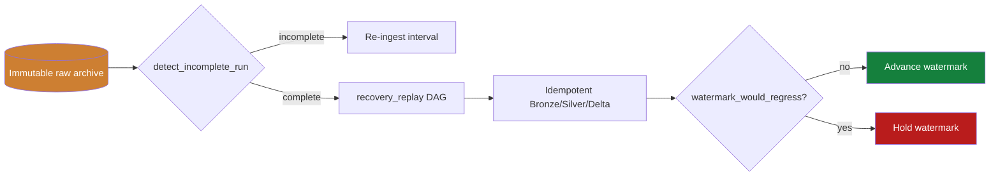

### Verified Acceptance Results

- 13 monitoring + recovery unit tests pass (redaction, JSON formatting, metrics,
  incomplete-run detection, watermark protection).
- Replay is idempotent by construction (verified in Milestone 5): reprocessing an
  archived run creates no duplicate records.
- Storage-level immutability is **not** claimed — raw archives are immutable by
  convention (append-only writers), not by object-lock, until configured.

See [`docs/runbooks/`](docs/runbooks/README.md).

---

## Milestone 11: CI/CD and Production Testing

Milestone 11 adds GitHub Actions workflows and a synthetic end-to-end test. PR CI
uses small deterministic data — it never requires the full historical dataset or
cloud credentials.

### CI jobs (`.github/workflows/ci.yml`)

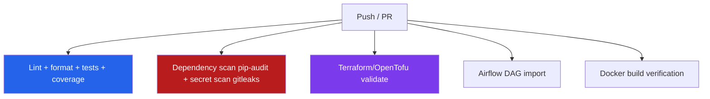

### Implemented Capabilities

- Lint (ruff), format check, unit + Spark + Delta tests with coverage.
- Dependency vulnerability scan (pip-audit) and secret scan (gitleaks).
- Terraform/OpenTofu fmt + validate; Airflow DAG-import job; Docker build check.
- Synthetic end-to-end pipeline test (`tests/test_end_to_end.py`).
- Separate manual benchmark workflow (`.github/workflows/benchmark.yml`).

### Verified Acceptance Results

- **153 tests passing, 1 skipped**, **85% line coverage** of `src/`.
- Workflow YAML validated; end-to-end synthetic pipeline (Bronze→Silver→Delta→
  Gold, including idempotent replay) passes locally.
- A documented test inventory maps every required scenario to a test
  ([`docs/TESTING.md`](docs/TESTING.md)).

> The GitHub Actions runs themselves execute on GitHub once pushed; they are
> authored and locally validated here but not triggered without a push.

---

## Milestone 12: Analytics Dashboard, Documentation, and Benchmarks

Milestone 12 adds a Streamlit dashboard over the **actual** Gold datasets, measured
benchmarks for every stage, and the portfolio/architecture documentation.

### Dashboard

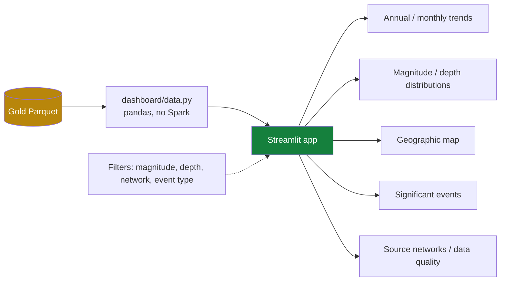

### Implemented Capabilities

- `dashboard/data.py`: testable data-access layer reading real Gold Parquet.
- `dashboard/app.py`: Streamlit UI with filters (magnitude, depth, network, event
  type) and trend/distribution/geographic/significant/quality views.
- Measured benchmarks for Bronze, Silver, Delta, and Gold (see
  [`docs/BENCHMARKS.md`](docs/BENCHMARKS.md)).
- Full documentation set (architecture, data model, data dictionary, deployment,
  security, testing, runbooks, cost estimates, walkthrough, interview prep).

### Verified Acceptance Results

- Dashboard reads real Gold: 281,421 events, annual counts sum to 281,421, M≥6
  filter returns 1,333 — all consistent with the pipeline outputs (no hardcoded
  numbers).
- Measured: Silver 11.15 s, Delta 11.37 s, Gold 6.13 s on the full dataset.
- 3 dashboard data-layer tests pass; app imports cleanly.

Run it: `make dashboard` (build Gold first with `make pipeline`). These views are
descriptive summaries of a magnitude-filtered catalog, **not** prediction.

---

## Complete Lakehouse Architecture

The platform implements the Medallion architecture, separating immutable raw
source data, validated scientific records, and analytical data products. The
diagram below is the **implemented** end-to-end system; components are labelled by
verification status in the table that follows.

Verification status of each environment:

| Status | Components |
|---|---|
| **Implemented & locally verified** | Historical + incremental ingestion, raw archival, manifest verification, PySpark Bronze, Bronze Parquet, Silver normalization + quality, Delta current-state + observed revisions, Gold Parquet datasets, Spark SQL, Streamlit, monitoring, recovery/replay |
| **Implemented & infrastructure-validated** | S3 storage adapter + mocked S3 tests, OpenTofu/Terraform modules, IAM policies, Airflow DAGs, Docker images, GitHub Actions |
| **Not deployed** | Live AWS S3 buckets, provisioned IAM, multi-node Spark clusters, managed production orchestration, production-scale cloud monitoring |

Raw storage uses a local filesystem by default, with an S3 backend available via
the storage abstraction. Gold outputs are **Parquet** datasets.

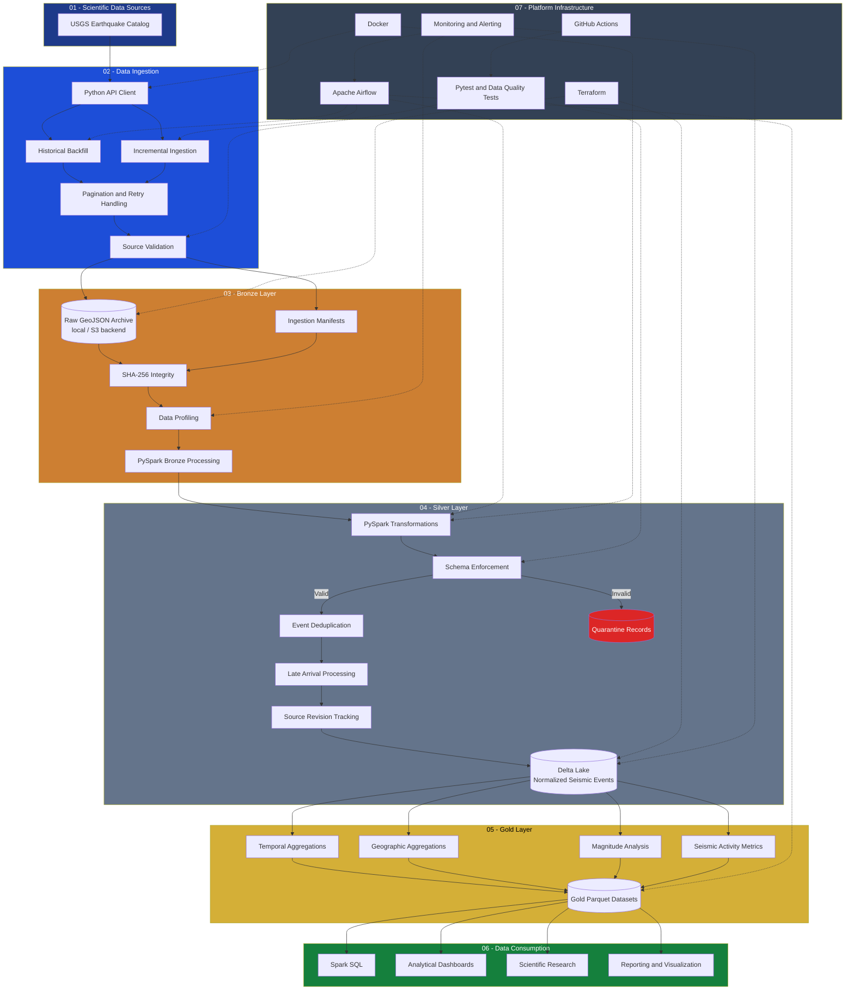

### Medallion Data Layers

```mermaid
flowchart LR
    A[USGS Source Data]

    A --> B[("BRONZE<br/>Original Raw Data")]

    B --> C[("SILVER<br/>Validated Scientific Data")]

    C --> D[("GOLD<br/>Analytical Parquet Products")]

    D --> E[Research and Analytics]

    style A fill:#1E40AF,color:#fff
    style B fill:#CD7F32,color:#fff
    style C fill:#64748B,color:#fff
    style D fill:#D4AF37,color:#000
    style E fill:#15803D,color:#fff
```

| Layer | Responsibility | Storage | Status |
|---|---|---|---|
| Raw | Original source payloads + provenance | GeoJSON (local/S3) | Implemented & verified |
| Bronze | Structured, schema-enforced events | Parquet | Implemented & verified |
| Silver | Validated/normalized events + revisions | Delta Lake | Implemented & verified |
| Gold | Aggregated analytical datasets | Parquet | Implemented & verified |

---

## Technology Stack

All components are implemented. The **Status** column records verification depth:
*verified* (exercised locally on real data), *validated* (config/structure checks
or mocked services), or *runs in CI*.

| Category | Technology | Version | Status |
|---|---|---|---|
| Programming | Python | 3.11 | verified |
| Scientific data source | USGS Earthquake Catalog | — | verified |
| API connectivity | Requests | 2.34 | verified |
| Raw data format | GeoJSON | — | verified |
| Distributed processing | Apache Spark / PySpark | 3.5.3 | verified (local mode) |
| Columnar storage | Apache Parquet | — | verified |
| Transactional storage | Delta Lake | 3.2.1 | verified |
| Analytical queries | Spark SQL | 3.5.3 | verified |
| Object storage | Local filesystem / AWS S3 adapter | boto3 1.44 | local verified; S3 mocked (moto) |
| Workflow orchestration | Apache Airflow | 2.10.5 | DAG imports verified; runs in CI |
| Infrastructure as Code | OpenTofu / Terraform | 1.13.9 | validated (`fmt`/`init`/`validate`); not applied |
| Containerization | Docker | — | image builds & runs; verified in CI |
| CI/CD | GitHub Actions | — | 5 jobs green |
| Data visualization | Streamlit | 1.67 | verified against real Gold |
| Testing | Pytest | 9.2 | 158 passing / 1 skipped |
| Code quality | Ruff | 0.17 | clean |
| Integrity verification | SHA-256 | — | verified |

---

## Repository Structure

```text
scientific-event-lakehouse/
├── src/
│   ├── ingestion/          # USGS client, windows, validation, archival, manifests, backfill
│   ├── profiling/          # Bronze integrity + statistical profiling
│   ├── config/             # centralized settings (paths, Spark, storage)
│   ├── spark/              # SparkSession factory (Delta-ready)
│   ├── schemas/            # explicit USGS GeoJSON PySpark schema
│   ├── bronze/             # distributed Bronze builder
│   ├── silver/             # canonical model + revision selection
│   ├── quality/            # configurable data-quality rule engine
│   ├── delta_lake/         # Delta MERGE, metadata, watermarks
│   ├── gold/               # star schema + datasets + SQL runner
│   ├── storage/            # local / S3 storage abstraction
│   ├── orchestration/      # Airflow-agnostic task callables
│   ├── monitoring/         # structured logging, metrics, alerts
│   └── recovery/           # failed-run detection, replay, watermark guard
├── airflow/
│   ├── dags/               # historical, incremental, recovery/replay DAGs
│   └── Dockerfile          # Airflow image (Java 17 + Spark/Delta)
├── infrastructure/terraform/
│   ├── modules/{s3_bucket,iam}/
│   └── environments/dev/
├── sql/analytics/          # 10 reusable Spark SQL queries
├── dashboard/              # Streamlit app + data-access layer
├── scripts/                # benchmark_bronze.py
├── tests/                  # 19 test modules (unit + Spark + Delta + e2e)
├── docs/                   # architecture, data dictionary, benchmarks, runbooks, audits
├── .github/workflows/      # ci.yml, benchmark.yml
├── Dockerfile              # pipeline runtime image
├── docker-compose.yml      # local Airflow
├── Makefile
├── requirements*.txt       # core, spark, aws, dashboard, dev
└── README.md
```

Generated data, manifests, profiling reports, virtualenvs, Terraform state, and
coverage artifacts are excluded from version control (`.gitignore`).

---

## Getting Started

### Prerequisites

- Python 3.11 or compatible version.
- Git.
- Internet access for USGS API extraction.
- Sufficient local storage for historical datasets.

### Clone the Repository

```bash
git clone https://github.com/blkpvnthr/scientific-event-lakehouse.git

cd scientific-event-lakehouse
```

### Create a Virtual Environment

```bash
python3 -m venv .venv

source .venv/bin/activate
```

### Install Dependencies

```bash
python -m pip install --upgrade pip

python -m pip install -r requirements.txt
```

### Validate the Environment

```bash
python --version

ruff --version

python -m pytest --version
```

---

## Running the Pipeline

All execution commands should be run from the repository root.

### Initial API Ingestion

```bash
python -m src.ingestion.ingest
```

### Daily Historical Backfill

```bash
python -m src.ingestion.backfill \
    --start-date 2024-01-01 \
    --end-date 2024-01-02 \
    --window-days 1 \
    --min-magnitude 2.5 \
    --page-size 100
```

### Weekly Historical Backfill

```bash
python -m src.ingestion.backfill \
    --start-date 2024-01-01 \
    --end-date 2024-01-08 \
    --window-days 7 \
    --min-magnitude 2.5 \
    --page-size 1000
```

### Annual Historical Backfill

```bash
time python -m src.ingestion.backfill \
    --start-date 2024-01-01 \
    --end-date 2025-01-01 \
    --window-days 30 \
    --min-magnitude 2.5 \
    --page-size 1000
```

### Ten-Year Historical Backfill

```bash
time python -m src.ingestion.backfill \
    --start-date 2015-01-01 \
    --end-date 2025-01-01 \
    --window-days 30 \
    --min-magnitude 2.5 \
    --page-size 1000
```

### Configuration Parameters

| Parameter | Description |
|---|---|
| --start-date | Inclusive UTC start date |
| --end-date | Exclusive UTC end date |
| --window-days | Historical extraction window size |
| --min-magnitude | Minimum earthquake magnitude |
| --page-size | Maximum records requested per page |

### Inspect Run Completion

Replace the placeholder with the generated run identifier.

```bash
export RUN_ID="your_run_id"

python -m json.tool \
    "data/manifests/run_id=$RUN_ID/_SUCCESS.json"
```

### Execute Bronze Profiling

```bash
time python -m src.profiling.profile_bronze \
    --run-id "$RUN_ID"
```

### Locate Generated Profiling Reports

```bash
find "data/profiles/run_id=$RUN_ID" \
    -type f \
    -name "*.json"
```

### Inspect Archive Disk Usage

```bash
find data/bronze \
    -type d \
    -name "run_id=$RUN_ID" \
    -exec du -sh {} \;
```

### Count Archived Payloads

```bash
find data/bronze \
    -path "*/run_id=$RUN_ID/*" \
    -type f \
    -name "*.json" | wc -l
```

---

## Automated Testing

The testing strategy includes unit tests, component
integration tests, filesystem integrity checks, and
synthetic source responses.

Integration tests use temporary directories and
mocked API responses to avoid modifying historical
archives or requiring live network access.

### Regression Test Inventory

| Test Module | Test Cases |
|---|---:|
| GeoJSON validation | 28 |
| Historical backfill | 10 |
| Atomic archival | 10 |
| Ingestion manifests | 10 |
| Date-window generation | 6 |
| USGS API client | 3 |
| Profiling utilities | 11 |
| Profile integration | 13 |
| **Verified regression suite** | **91** |

The final regression suite passed all 91 automated tests
in 0.30 seconds. Ruff linting and formatting checks also
passed successfully across all 20 Python files.

### Testing Architecture

```mermaid
flowchart TD
    A[Pytest Regression Suite]

    A --> B[Unit Tests]
    A --> C[Integration Tests]

    B --> D[API Client]
    B --> E[Date Windows]
    B --> F[GeoJSON Validation]
    B --> G[Checksums and Archival]
    B --> H[Manifest Serialization]
    B --> I[Statistical Utilities]

    C --> J[Mock USGS API]

    J --> K[Real Backfill Pipeline]

    K --> L[(Temporary Bronze Archive)]
    K --> M[Temporary Manifests]

    L --> N[Real Bronze Profiler]
    M --> N

    N --> O[Successful Execution Tests]
    N --> P[Corruption and Failure Tests]
    N --> Q[Data Quality Edge Cases]

    O --> R{Regression Gate}
    P --> R
    Q --> R

    R -->|Pass| S[Release Candidate]
    R -->|Fail| T[Correct Implementation]

    style L fill:#CD7F32,color:#fff
    style N fill:#2563EB,color:#fff
    style S fill:#15803D,color:#fff
    style T fill:#DC2626,color:#fff
```

### Run the Full Regression Suite

```bash
python -m pytest -v
```

### Run Profiling Tests

```bash
python -m pytest \
    tests/test_profile_bronze.py \
    tests/test_profile_integration.py \
    -v
```

### Code Quality Checks

```bash
ruff check .
```

```bash
ruff format --check .
```

### Complete Release Quality Gate

```bash
ruff check . && \
ruff format --check . && \
python -m pytest -q && \
git diff --check
```

---

## Development Roadmap

All twelve milestones are complete. The roadmap below shows the delivered
sequence; green = implemented & locally verified, blue = implemented &
infrastructure-validated (not deployed), gray = optional future work.

```mermaid
flowchart TD
    subgraph P1["Phase I - Data Acquisition"]
        M1["1. Initial API Ingestion"]
        M2["2. Historical Ingestion"]
    end

    subgraph P2["Phase II - Lakehouse Processing"]
        M3["3. PySpark Bronze"]
        M4["4. Silver Quality"]
        M5["5. Delta Lake"]
        M6["6. Gold Analytics"]
    end

    subgraph P3["Phase III - Platform Infrastructure"]
        M7["7. S3 Integration"]
        M8["8. Infrastructure as Code"]
        M9["9. Airflow"]
    end

    subgraph P4["Phase IV - Operational Engineering"]
        M10["10. Monitoring and Recovery"]
        M11["11. CI/CD and Testing"]
        M12["12. Dashboard and Benchmarks"]
    end

    M1 --> M2 --> M3 --> M4
    M4 --> M5 --> M6 --> M7
    M7 --> M8 --> M9 --> M10
    M10 --> M11 --> M12

    M12 --> RELEASE["v1.0.0 Stable Release"]
    RELEASE -.-> CLOUD["Optional Future AWS Deployment"]

    classDef complete fill:#15803D,color:#fff
    classDef validated fill:#2563EB,color:#fff
    classDef future fill:#475569,color:#fff

    class M1,M2,M3,M4,M5,M6,M9,M10,M11,M12,RELEASE complete
    class M7,M8 validated
    class CLOUD future
```

### Delivered (Phases I–IV)

- [x] USGS API connectivity, pagination, retry/backoff, GeoJSON validation.
- [x] Atomic archival, SHA-256 checksums, manifests, ten-year backfill, profiling.
- [x] Distributed PySpark Bronze with explicit schemas and reconciliation.
- [x] Silver normalization, data-quality rules, quarantine, revision selection.
- [x] Delta Lake current-state + observed revisions, schema evolution, time travel.
- [x] Gold star schema, 10 datasets, 10 reusable Spark SQL queries.
- [x] Local/S3 storage abstraction (mocked S3 tests).
- [x] OpenTofu/Terraform modules (validated), Docker images, Airflow DAGs.
- [x] Watermark management (advance-only, quality-gated).
- [x] Monitoring/metrics/alerts, recovery + replay, runbooks.
- [x] GitHub Actions CI, synthetic end-to-end test, Streamlit dashboard, benchmarks.
- [x] Published **v1.0.0** stable release.

### Optional future work (requires authorization)

- [ ] Provision live AWS S3 + IAM (`terraform apply`).
- [ ] Run the pipeline against `s3://` with the `hadoop-aws` JARs.
- [ ] Deploy managed orchestration (e.g. MWAA) and multi-node Spark.

---

## Known Limitations

Honest scope boundaries of this reference implementation:

- **Local-mode Spark** on a single machine — measured figures are not
  distributed-cluster performance.
- **Single-writer Delta** — no concurrent multi-writer guarantees.
- Raw archival prevents application-level overwrites but does **not** provide
  storage-enforced immutability (no object-lock configured).
- SHA-256 detects payload changes relative to recorded manifests but does not
  authenticate the source.
- Matching source counts do not guarantee snapshot consistency against the
  mutable USGS catalog; only **observed** revisions are reconstructed, never
  unobserved prior source states.
- Data-quality verification enforces integrity and plausibility but does not
  establish complete scientific validity.
- Cloud infrastructure is **validated but not deployed**; no live AWS resources
  exist.

---

## Completed End-to-End Data Flow

The verified pipeline processes the 281,421-record archive through every layer
to analytics and supports recovery/replay. Each stage is implemented and
reconciled (see the milestone sections above).

```mermaid
flowchart LR
    A[("Raw GeoJSON Archive<br/>347 files · 281,421 records")]
    A --> V["Manifest + SHA-256 Verification"]
    V --> B["PySpark Feature Extraction"]
    B --> C[("Structured Bronze Parquet")]
    C --> D["Silver Normalization + Quality"]
    D --> E[("Delta Current + Observed Revisions")]
    D --> Q[("Quarantine")]
    E --> F[("Gold Parquet Datasets")]
    F --> G["Spark SQL + Streamlit Dashboard"]
    E -. replay .-> R["Recovery / Replay DAG"]
    R -. idempotent .-> B

    style A fill:#CD7F32,color:#fff
    style C fill:#CD7F32,color:#fff
    style E fill:#64748B,color:#fff
    style Q fill:#B91C1C,color:#fff
    style F fill:#D4AF37,color:#000
    style G fill:#15803D,color:#fff
```

Delivered in this flow:

- Local Spark execution with explicit PySpark schemas.
- Distributed GeoJSON parsing, nested feature extraction, attribute normalization.
- Columnar Parquet storage, event-year partitioning, distributed reconciliation.
- Transactional Delta current-state + observed revisions; idempotent replay.
- Transformation unit tests and measured per-stage benchmarks.

---

## Analytics Dashboard

A Streamlit dashboard (`dashboard/app.py`) consumes the **actual** Gold datasets
(no hardcoded values) via a testable pandas data-access layer (`dashboard/data.py`).

Views: annual/monthly trends, magnitude and depth distributions, a geographic
map, significant events (M≥6 or significance≥600), source-network metrics, and
data-quality trends. Filters: magnitude, depth, reporting network, and event type
(applied to the event-level fact table).

```bash
make pipeline       # build Gold first
make dashboard      # http://localhost:8501
```

Verified against the full dataset: 281,421 events, annual counts summing to
281,421, and 1,333 events of magnitude ≥ 6.0. These are descriptive summaries of
a magnitude-filtered catalog, not earthquake prediction.

---

## Releases

| Version | Scope |
|---|---|
| [`v1.0.0`](https://github.com/blkpvnthr/scientific-event-lakehouse/releases/tag/v1.0.0) | Verified complete reference implementation |
| `v0.11.0` | CI/CD and production testing |
| `v0.10.0` | Observability, recovery, replay |
| `v0.9.0` | Apache Airflow orchestration |
| `v0.8.0` | Terraform infrastructure |
| `v0.7.0` | AWS S3 integration |
| `v0.6.0` | Gold analytics |
| `v0.5.0` | Delta Lake and versioning |
| `v0.4.0` | Silver normalization and quality |
| `v0.3.0` | Distributed PySpark Bronze |
| [`v0.2.0`](https://github.com/blkpvnthr/scientific-event-lakehouse/releases/tag/v0.2.0) | Historical ingestion and profiling |

Each milestone tag points at its verified merge commit. **v1.0.0** is the latest
stable release.

---

## Technical Documentation

| Document | Contents |
|---|---|
| [`docs/architecture/SYSTEM_ARCHITECTURE.md`](docs/architecture/SYSTEM_ARCHITECTURE.md) | End-to-end system + component status |
| [`docs/architecture/PIPELINE_ARCHITECTURE.md`](docs/architecture/PIPELINE_ARCHITECTURE.md) | Layer contracts, lineage, time semantics |
| [`docs/architecture/DATA_MODEL.md`](docs/architecture/DATA_MODEL.md) | Gold star schema |
| [`docs/data_dictionary/EARTHQUAKE_SCHEMA.md`](docs/data_dictionary/EARTHQUAKE_SCHEMA.md) | Bronze schema |
| [`docs/data_dictionary/GOLD_TABLES.md`](docs/data_dictionary/GOLD_TABLES.md) | Gold datasets |
| [`docs/DATA_QUALITY.md`](docs/DATA_QUALITY.md) | Rule catalog + thresholds |
| [`docs/BENCHMARKS.md`](docs/BENCHMARKS.md) | Measured performance |
| [`docs/TESTING.md`](docs/TESTING.md) | Test inventory + scenario map |
| [`docs/DEPLOYMENT.md`](docs/DEPLOYMENT.md) · [`docs/SECURITY.md`](docs/SECURITY.md) | Deployment + security posture |
| [`docs/LOCAL_DEVELOPMENT.md`](docs/LOCAL_DEVELOPMENT.md) | Developer quickstart |
| [`docs/runbooks/`](docs/runbooks/README.md) | Operational runbooks |
| [`docs/RELEASE_AUDIT.md`](docs/RELEASE_AUDIT.md) | Release-readiness audit |
| [`docs/PROJECT_WALKTHROUGH.md`](docs/PROJECT_WALKTHROUGH.md) · [`docs/INTERVIEW_PREPARATION.md`](docs/INTERVIEW_PREPARATION.md) | Portfolio walkthrough + Q&A |

---

## Data Source

USGS Earthquake Catalog

- Catalog: https://earthquake.usgs.gov/earthquakes/search/
- API Documentation: https://earthquake.usgs.gov/fdsnws/event/1/

Source records are retrieved from the public USGS
Earthquake Catalog and preserved for scientific
data engineering and analytical development.

---

## Project Status

Complete — all 12 milestones implemented, verified, and released.

Latest stable release: **v1.0.0**. Current HEAD is CI-green on `main`.

Optional future work (requires authorization): live AWS deployment via
`terraform apply`, running the pipeline against S3, and managed orchestration.

---

## Milestone 2 Acceptance Report

**Verification date:** November 22, 2026

**Historical run:** `3d8d9a251f33489e807356890c692789`

| Acceptance Criterion | Result | Status |
|---|---|---|
| Historical extraction completed | 122 windows | PASS |
| Expected archived files | 347 | PASS |
| Record reconciliation | 281,421 records | PASS |
| Global event uniqueness | 281,421 unique events | PASS |
| Duplicate records | 0 | PASS |
| Logical payload size | 201,979,748 bytes | PASS |
| Historical coverage | 2015-01-01 to 2025-01-01 exclusive | PASS |
| Minimum magnitude threshold | 2.5 | PASS |
| Historical integrity | PASS | PASS |
| Automated regression suite | 91/91 | PASS |
| Regression execution time | 0.30 seconds | PASS |
| Ruff linting | All checks passed | PASS |
| Ruff formatting | 20 files formatted | PASS |

The historical ingestion and profiling implementation has
satisfied its defined technical acceptance criteria.

The dataset is eligible for subsequent distributed Bronze
processing, subject to the explicit schema and scientific
data quality requirements introduced in future milestones.

