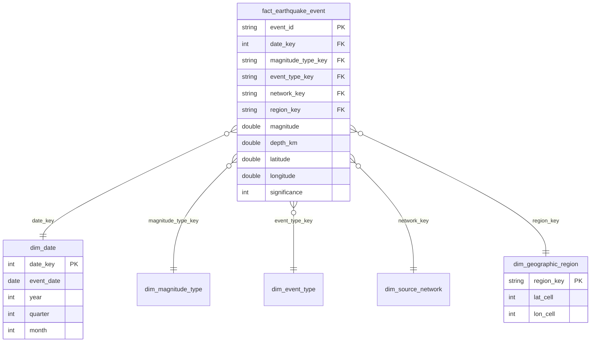

# Analytical Data Model (Gold)

The Gold layer uses a star schema derived from the Silver
`earthquake_events_current` Delta table. Every fact and aggregate is computed
from that single validated current-state table, so all Gold counts reconcile to
it.

## Star schema

## Grain and keys

| Table | Grain | Logical key |
|---|---|---|
| `fact_earthquake_event` | one current event | `event_id` |
| `dim_date` | one calendar day | `date_key` (yyyymmdd) |
| `dim_magnitude_type` | one magnitude type | `magnitude_type_key` |
| `dim_event_type` | one event type | `event_type_key` |
| `dim_source_network` | one reporting network | `network_key` |
| `dim_geographic_region` | one 10° grid cell | `region_key` |

`region_key` is a deterministic 10°×10° grid cell (`lat<cell>_lon<cell>`). A
documented grid is used instead of named political/tectonic regions because the
latter would require an external boundary dataset not present in this project.

## Scientific caveats

These are summaries of a **magnitude ≥ 2.5 observational catalog**. Counts
reflect catalog coverage, station density, and reporting practices, and mix
different magnitude types. They are descriptive summaries, **not** earthquake
prediction, and must not be read as forecasts of future activity.
