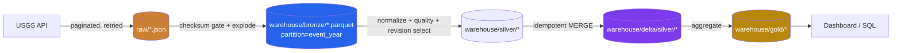

# Pipeline Architecture

Data flow and transformation contract for each medallion layer.

## Data lineage

## Layer contracts

| Layer | Input | Transform | Output | Reconciliation |
|---|---|---|---|---|
| Raw | USGS API | paginate, validate, checksum, archive | immutable GeoJSON | count before==after==unique |
| Bronze | raw files | verify checksum, parse, explode, extract, UTC, provenance | Parquet by `event_year` | output records == manifest totals; files == 347 |
| Silver | Bronze | normalize, fingerprint, quality rules, revision select | current / revisions / quarantine / quality | valid+quarantined==input; current+superseded==valid |
| Delta | Silver | idempotent MERGE (newer-wins, insert-only revisions) | transactional tables | replay adds 0 revisions |
| Gold | Delta current | star schema + aggregates | fact + dims + 10 datasets | fact == current events |

## Time semantics

Four distinct timestamps are preserved end to end and never conflated:

| Time | Column | Meaning |
|---|---|---|
| Occurrence | `event_time` | when the earthquake happened |
| Source revision | `updated_time` | when USGS last revised the record |
| Ingestion | `ingestion_timestamp` | when the raw page was archived |
| Processing | `processing_timestamp` | when the record was (re)processed |

All timestamps are UTC. Revision selection and watermarks use `updated_time`
(source revision time), not occurrence or processing time.

## Incremental semantics

USGS filters events by origin time but revises records after the fact. The
incremental DAG re-queries an overlap window (default 7 days) back from the
watermark; downstream fingerprint-keyed MERGE makes the overlap idempotent. The
data-quality gate runs **before** the Delta merge, and the watermark advances only
in that merge, on success, and only if the new value is greater — so a fatal
quality failure, any upstream failure, or an out-of-order run never advances or
corrupts it.
