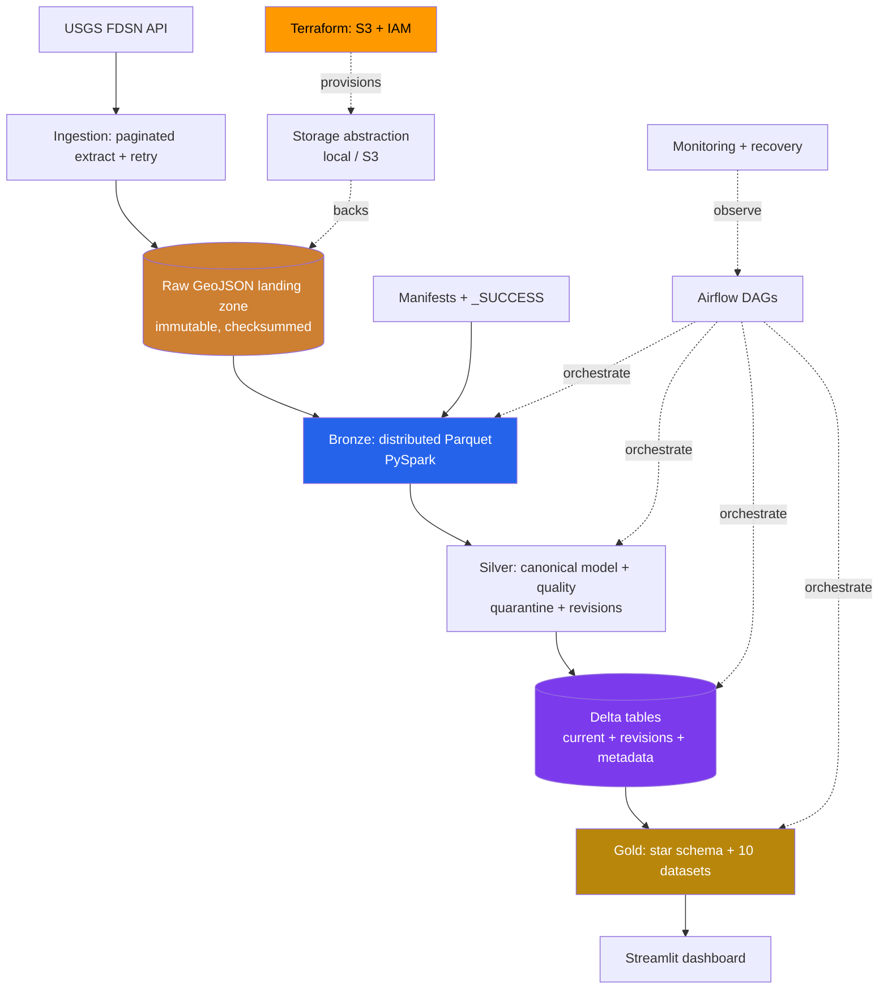

# System Architecture

End-to-end architecture of the Scientific Event Data Lakehouse. Components are
labelled by verification status: **implemented + locally verified** vs
**authored, cloud-deploy pending authorization**.

## Overview

## Component status

| Component | Status |
|---|---|
| Ingestion, raw archival, manifests, profiling | Implemented + verified (M1–2) |
| Bronze (PySpark Parquet) | Implemented + verified (M3) |
| Silver (canonical + quality) | Implemented + verified (M4) |
| Delta tables + versioning | Implemented + verified (M5) |
| Gold (star schema + datasets + SQL) | Implemented + verified (M6) |
| Storage abstraction (local + S3) | Implemented; S3 via mock (M7) |
| Terraform (S3 + IAM) | Authored + validated; **not applied** (M8) |
| Airflow DAGs | Authored; imports verified (M9) |
| Observability + recovery | Implemented + verified (M10) |
| CI/CD | Authored + locally validated (M11) |
| Dashboard | Implemented; reads real Gold (M12) |
| Live AWS deployment | **Pending authorization** |

## Key design principles

- **Immutability of raw**: the raw GeoJSON archive is never modified; all layers
  are derived and reproducible from it.
- **Reconciliation at every layer**: record counts are reconciled to the prior
  layer; drift raises.
- **Idempotency**: overwrite-by-partition (Bronze) and fingerprint-keyed MERGE
  (Delta) make reprocessing safe.
- **Deterministic, explicit schemas**: no inferred types; no fabricated values.
- **Separation of concerns**: storage, Spark session, config, and orchestration
  are centralized and swappable.
